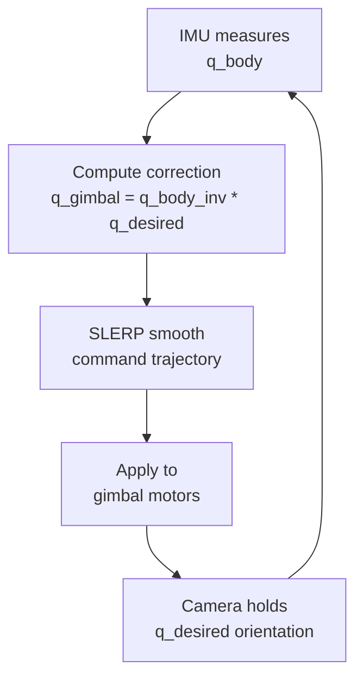

import RoboticsComments from '../../../../components/robotics/RoboticsComments.astro';
import TawkWidget from '../../../../components/TawkWidget.astro';
import UniversalContentContributors from '../../../../components/UniversalContentContributors.astro';
import InArticleAd from '../../../../components/InArticleAd.astro';
import Copyright from '../../../../components/Copyright.astro';
import BionicText from '../../../../components/BionicText.astro';
import TailwindWrapper from '../../../../components/TailwindWrapper.jsx';
import { Tabs, TabItem } from '@astrojs/starlight/components';
import { Card, CardGrid, Badge, Steps, LinkButton, FileTree } from '@astrojs/starlight/components';

<UniversalContentContributors 
  contributors={frontmatter.contributors}
/>


import PodcastEmbed from '../../../../components/PodcastEmbed.astro';

Tilt a drone camera until it looks straight down, and the picture can start to spin while the motors jerk. A robot wrist can do the same in the middle of a weld. Nothing is broken. The fault is in how the orientation is stored: as three angles, which fail at one pose. This lesson shows why they fail and what to store in their place: a quaternion, four numbers that describe one turn about one axis. You will use it to hold a drone camera steady and to move a tool smoothly from one orientation to another. #robotics #quaternions #orientation-control

<PodcastEmbed src="https://open.spotify.com/episode/1khwI5dNHsHDBZKMOrwKCt?si=qGHKuTQqS82z6dHmhabKFw" />

## Learning Objectives

By the end of this lesson, you will be able to:

1. **Identify** gimbal lock in Euler angle representations and explain why it causes loss of control
2. **Construct** unit quaternions from axis-angle representations and compose rotations via quaternion multiplication
3. **Implement** SLERP interpolation for smooth orientation transitions in robotic systems
4. **Apply** quaternion operations to rotate vectors and compose sequential 3D rotations without singularities
5. **Compare** Euler angles, rotation matrices, and quaternions for different robotic applications

## Real-World Engineering Challenge: Drone Gimbal Stabilization and Surgical Tool Orientation

<InArticleAd />


A camera drone tilts and turns in the wind, and the camera must stay level. A gimbal does this work: it is a mount with three motors, one inside the next, that turns the camera against the motion of the drone body. A surgical robot has a similar task. It must turn its tool from one orientation to another with no sudden jump. Both machines need a way to store an orientation that works at every pose.

### The Orientation Control Challenge

> **Engineering Question:** How do we store an orientation, and move between two orientations, so that a drone gimbal or a surgical tool never loses the ability to turn in some direction?

### Why Not Just Use Euler Angles Everywhere?

The familiar way to store an orientation is three angles: yaw (turn left or right), pitch (tilt up or down) and roll (lean sideways). They are called Euler angles. People read them easily, and for small turns they work well.

They have one weak pose. The three turns are made one after another, each about its own axis. When the middle turn reaches 90 degrees, the axis of the first turn and the axis of the third turn point along the same line. Two motors now do the same thing, and one direction of turning is lost. This pose has a name: gimbal lock. Near it, the motors must spin very fast to make a small turn. A quaternion does not have such a pose.

## Fundamental Theory: Quaternion-Based Orientation

<InArticleAd />


### Euler Angles Review: Roll, Pitch, Yaw

Euler angles describe an orientation as three turns made one after another. The most common order in robotics and aerospace is ZYX:

1. Turn about the Z-axis (the vertical axis) by the yaw angle $\psi$.
2. Turn about the Y-axis, in the position the first turn left it, by the pitch angle $\theta$.
3. Turn about the X-axis, in the position the first two turns left it, by the roll angle $\phi$.

The three angles are in degrees or radians. Each turn can be written as a rotation matrix, a 3 by 3 table of numbers that turns a vector (see [3D Rotation Matrices and Spatial Transformations](/education/spatial-mechanics/spatial-rotations-transformations/)). Multiplying the three matrices gives one matrix for the whole orientation:

$$
R_{ZYX} = R_Z(\psi) \, R_Y(\theta) \, R_X(\phi)
$$

Written out in full (the next part uses it):

$$
R_{ZYX} = \begin{bmatrix}
\cos\psi\cos\theta & \cos\psi\sin\theta\sin\phi - \sin\psi\cos\phi & \cos\psi\sin\theta\cos\phi + \sin\psi\sin\phi \\
\sin\psi\cos\theta & \sin\psi\sin\theta\sin\phi + \cos\psi\cos\phi & \sin\psi\sin\theta\cos\phi - \cos\psi\sin\phi \\
-\sin\theta & \cos\theta\sin\phi & \cos\theta\cos\phi
\end{bmatrix}
$$

:::note[Euler Angle Conventions]
There are 12 possible orders of the three turns (XYZ, ZYX, ZXZ and others). The same three numbers mean a different orientation in a different order, so check which order your software library uses before you combine angles from two sources.
:::

### The Gimbal Lock Problem

Think of a drone gimbal as three rings, one inside the next: the yaw ring outside, the pitch ring in the middle, and the roll ring inside, holding the camera. The pitch ring carries the roll axis with it.

```text
  Pitch = 0                        Pitch = 90 degrees

     yaw axis                         yaw axis
        |                                |
        |                                |
        +-------> roll axis              +
       /                                /|
      /                                / |
  pitch axis                   pitch  /  v roll axis
                               axis

  3 axes in 3 directions           yaw and roll on one line
  3 directions of turning          2 directions of turning
```

When the pitch ring turns $90°$, the roll axis points straight down, along the yaw axis. The yaw motor and the roll motor now turn the camera in the same way, and no motor can turn it about the third direction. One degree of freedom (one independent direction of motion) is lost. This is gimbal lock. It occurs in any Euler angle sequence when the middle turn reaches $\pm 90°$.

The matrix shows the same thing. Put $\theta = 90°$ into $R_{ZYX}$, so that $\cos\theta = 0$ and $\sin\theta = 1$:

$$
R_{ZYX}\big|_{\theta=90°} = \begin{bmatrix}
0 & \cos\psi\sin\phi - \sin\psi\cos\phi & \cos\psi\cos\phi + \sin\psi\sin\phi \\
0 & \sin\psi\sin\phi + \cos\psi\cos\phi & \sin\psi\cos\phi - \cos\psi\sin\phi \\
-1 & 0 & 0
\end{bmatrix}
$$

The identities $\sin(a - b) = \sin a\cos b - \cos a\sin b$ and $\cos(a - b) = \cos a\cos b + \sin a\sin b$ shorten each entry:

$$
R_{ZYX}\big|_{\theta=90°} = \begin{bmatrix}
0 & \sin(\phi - \psi) & \cos(\phi - \psi) \\
0 & \cos(\phi - \psi) & -\sin(\phi - \psi) \\
-1 & 0 & 0
\end{bmatrix}
$$

Only the difference $\phi - \psi$ appears. Yaw $40°$ with roll $30°$ gives the same matrix as yaw $50°$ with roll $40°$, because $30° - 40° = 40° - 50° = -10°$. Two motors turn, but only one number of the orientation changes. The program below checks this.

```python
# Demonstrating gimbal lock with Euler angles
import numpy as np
from scipy.spatial.transform import Rotation
# 'ZYX' in capital letters: each turn is about the axis as the earlier turns left it

# Normal case: pitch = 45 degrees (no gimbal lock)
r_normal = Rotation.from_euler('ZYX', [30, 45, 20], degrees=True)
print("Normal case (pitch=45°):")
print(f"  Euler ZYX: {r_normal.as_euler('ZYX', degrees=True).round(2)}")

# Gimbal lock case: pitch = 90 degrees
r_locked = Rotation.from_euler('ZYX', [30, 90, 20], degrees=True)
euler_recovered = r_locked.as_euler('ZYX', degrees=True)
print("\nGimbal lock case (pitch=90°):")
print(f"  Input:     yaw=30, pitch=90, roll=20")
print(f"  Recovered: {euler_recovered.round(2)}")
print(f"  Note: yaw and roll are entangled (only their difference is recoverable)")

# Show that different yaw/roll combos give the same rotation at pitch=90
r1 = Rotation.from_euler('ZYX', [40, 90, 30], degrees=True)
r2 = Rotation.from_euler('ZYX', [50, 90, 40], degrees=True)
print(f"\n  R1 (yaw=40, pitch=90, roll=30) vs R2 (yaw=50, pitch=90, roll=40):")
print(f"  Same rotation? {np.allclose(r1.as_matrix(), r2.as_matrix())}")
print(f"  (Both have yaw-roll = 10°, producing identical orientations)")
```

### Quaternion Definition

Any orientation can be reached from any other by a single turn: choose the right axis, and turn about it by the right angle. A quaternion stores that single turn in four numbers. One number carries the size of the angle, and three carry the direction of the axis. Because it stores one turn, and not three turns in a row, there is no middle turn that can bring two axes onto one line. Gimbal lock cannot occur.

The four numbers also follow rules of multiplication, and these rules let a program combine two turns into one. A quaternion $\mathbf{q}$ has one ordinary number $w$ (the scalar part) and three more, $x$, $y$ and $z$ (the vector part). None of them has a unit:

$$
\mathbf{q} = w + x\,\mathbf{i} + y\,\mathbf{j} + z\,\mathbf{k}
$$

The symbols $\mathbf{i}$, $\mathbf{j}$, $\mathbf{k}$ mark the three places of the vector part. They behave like the imaginary unit of complex numbers, but there are three of them:

$$
\mathbf{i}^2 = \mathbf{j}^2 = \mathbf{k}^2 = \mathbf{i}\,\mathbf{j}\,\mathbf{k} = -1
$$

The multiplication rules follow from these identities:

$$
\begin{aligned}
\mathbf{i}\,\mathbf{j} &= \mathbf{k}, \quad \mathbf{j}\,\mathbf{k} = \mathbf{i}, \quad \mathbf{k}\,\mathbf{i} = \mathbf{j} \\
\mathbf{j}\,\mathbf{i} &= -\mathbf{k}, \quad \mathbf{k}\,\mathbf{j} = -\mathbf{i}, \quad \mathbf{i}\,\mathbf{k} = -\mathbf{j}
\end{aligned}
$$

:::note[Quaternion Notation]
A quaternion is often written as $\mathbf{q} = [w, \mathbf{v}]$ where $w$ is the scalar part and $\mathbf{v} = (x, y, z)$ is the vector part. Some libraries use the convention $[x, y, z, w]$ (scalar-last). Always check your library's convention. SciPy uses scalar-last: `[x, y, z, w]`.
:::

:::note[Hamilton vs JPL: Two Quaternion Conventions]
The rules above ($\mathbf{i}\mathbf{j} = \mathbf{k}$, $\mathbf{i}\mathbf{j}\mathbf{k} = -1$) are the **Hamilton** convention. Most robotics libraries use it: SciPy `Rotation`, Eigen, ROS `tf2`, MoveIt and Drake. A second convention, called **JPL** or **Shuster**, satisfies $\mathbf{i}\mathbf{j}\mathbf{k} = +1$ and is found in spacecraft work and in some drivers for inertial sensors. A JPL quaternion read by a Hamilton library gives the opposite turn, with no error message. This lesson uses Hamilton throughout.
:::

### Unit Quaternions and the Rotation Constraint

Only a quaternion of length 1 represents a turn. It is called a unit quaternion:

$$
\|\mathbf{q}\| = \sqrt{w^2 + x^2 + y^2 + z^2} = 1
$$

Four numbers with one condition leave three free values, which is exactly what an orientation needs. Rounding errors slowly change the length, so a program divides the quaternion by its length from time to time. This is called normalizing.

One fact causes many program errors: $\mathbf{q}$ and $-\mathbf{q}$ (all four signs changed) represent the same turn. It is called the **double cover**, and it returns in the part on SLERP.

### Quaternion from Axis-Angle Representation

Take a turn by an angle $\theta$ about an axis. Write the axis as a vector of length 1, $\hat{\mathbf{n}} = (n_x, n_y, n_z)$. The scalar part of the quaternion is the cosine of half the angle. The vector part is the axis multiplied by the sine of half the angle:

```text
  A turn: axis and angle          The quaternion: four numbers

      n (axis, length 1)          q = [ w,   x,  y,  z ]
       |                                |    |
       |  theta                         |    +-- sin(theta/2) * n
       | /  (angle of the turn)         |
       |/                               +-- cos(theta/2)
       +
```

$$
\mathbf{q} = \left[\cos\frac{\theta}{2},\;\; \sin\frac{\theta}{2}\,\hat{\mathbf{n}}\right] = \cos\frac{\theta}{2} + \sin\frac{\theta}{2}\,(n_x\,\mathbf{i} + n_y\,\mathbf{j} + n_z\,\mathbf{k})
$$

**Example:** a $90°$ turn about the Z-axis, so $\theta = 90°$ and $\hat{\mathbf{n}} = (0, 0, 1)$:

$$
w = \cos\frac{90°}{2} = \cos 45° = 0.707, \qquad (x, y, z) = \sin 45° \times (0, 0, 1) = (0,\; 0,\; 0.707)
$$

$$
\mathbf{q} = [w, x, y, z] = [0.707,\; 0,\; 0,\; 0.707]
$$

Its length is $\sqrt{0.707^2 + 0.707^2} = 1$, as it must be.

```python
import numpy as np
from scipy.spatial.transform import Rotation

# Create quaternion from axis-angle
axis = np.array([0, 0, 1])  # Z-axis
angle_deg = 90
angle_rad = np.radians(angle_deg)

# Manual computation
w = np.cos(angle_rad / 2)
xyz = np.sin(angle_rad / 2) * axis
print(f"90° rotation about Z-axis:")
print(f"  Quaternion [x,y,z,w]: [{xyz[0]:.4f}, {xyz[1]:.4f}, {xyz[2]:.4f}, {w:.4f}]")

# Using scipy (scalar-last convention)
r = Rotation.from_rotvec(angle_rad * axis)
quat = r.as_quat()  # [x, y, z, w]
print(f"  SciPy quaternion:     {quat.round(4)}")
print(f"  Rotation matrix:\n{r.as_matrix().round(4)}")
```

### Quaternion Multiplication (Rotation Composition)

To make one turn and then another, multiply their quaternions. The product is one quaternion for the combined turn. Write $\mathbf{q}_1 = [w_1, \mathbf{v}_1]$ and $\mathbf{q}_2 = [w_2, \mathbf{v}_2]$, where $\mathbf{v}$ is the vector part. The product uses the dot product ($\cdot$) and the cross product ($\times$) of the two vector parts:

$$
\mathbf{q}_1 \otimes \mathbf{q}_2 = \begin{bmatrix}
w_1 w_2 - \mathbf{v}_1 \cdot \mathbf{v}_2 \\
w_1 \mathbf{v}_2 + w_2 \mathbf{v}_1 + \mathbf{v}_1 \times \mathbf{v}_2
\end{bmatrix}
$$

Written out with the four numbers of each, $\mathbf{q}_1 = [w_1, x_1, y_1, z_1]$ and $\mathbf{q}_2 = [w_2, x_2, y_2, z_2]$, this is 16 multiplications:

$$
\mathbf{q}_1 \otimes \mathbf{q}_2 = \begin{bmatrix}
w_1 w_2 - x_1 x_2 - y_1 y_2 - z_1 z_2 \\
w_1 x_2 + x_1 w_2 + y_1 z_2 - z_1 y_2 \\
w_1 y_2 - x_1 z_2 + y_1 w_2 + z_1 x_2 \\
w_1 z_2 + x_1 y_2 - y_1 x_2 + z_1 w_2
\end{bmatrix}
$$

:::note[Multiplication Order]
The order matters: in general $\mathbf{q}_1 \otimes \mathbf{q}_2 \neq \mathbf{q}_2 \otimes \mathbf{q}_1$. Turn a book $90°$ about a vertical axis and then $90°$ about a horizontal one, then repeat in the other order: it ends in a different pose. To make turn $\mathbf{q}_1$ first and then $\mathbf{q}_2$, both about the fixed axes of the room, write $\mathbf{q}_2 \otimes \mathbf{q}_1$. The first turn stands on the right, as with rotation matrices.
:::

```python
import numpy as np
from scipy.spatial.transform import Rotation

# Compose two rotations: 90° about Z, then 90° about X
r1 = Rotation.from_euler('z', 90, degrees=True)  # First rotation
r2 = Rotation.from_euler('x', 90, degrees=True)  # Second rotation

# Compose: r2 applied after r1
r_combined = r2 * r1  # SciPy uses * for quaternion composition

print("Rotation 1 (90° about Z):")
print(f"  Quaternion [x,y,z,w]: {r1.as_quat().round(4)}")
print("Rotation 2 (90° about X):")
print(f"  Quaternion [x,y,z,w]: {r2.as_quat().round(4)}")
print("Combined (R2 after R1):")
print(f"  Quaternion [x,y,z,w]: {r_combined.as_quat().round(4)}")
print(f"  Euler ZYX: {r_combined.as_euler('ZYX', degrees=True).round(2)}")

# Verify: order matters
r_reversed = r1 * r2  # r1 applied after r2
print(f"\nReversed order quaternion: {r_reversed.as_quat().round(4)}")
print(f"Same as combined? {np.allclose(r_combined.as_quat(), r_reversed.as_quat())}")
```

### Quaternion Conjugate and Inverse

To undo a turn, turn back about the same axis by the same angle. The conjugate $\mathbf{q}^*$ does this: it keeps $w$ and changes the sign of $x$, $y$ and $z$.

$$
\mathbf{q}^* = w - x\,\mathbf{i} - y\,\mathbf{j} - z\,\mathbf{k} = [w, -\mathbf{v}]
$$

The inverse $\mathbf{q}^{-1}$ is the quaternion that undoes $\mathbf{q}$. In general it is the conjugate divided by the length squared. For a unit quaternion the length is 1, so the inverse is the conjugate:

$$
\mathbf{q}^{-1} = \frac{\mathbf{q}^*}{\|\mathbf{q}\|^2} = \mathbf{q}^* \quad \text{when } \|\mathbf{q}\| = 1
$$

A turn followed by its inverse is no turn at all: $\mathbf{q} \otimes \mathbf{q}^* = [1, \mathbf{0}]$, the identity quaternion.

### Rotating Vectors with Quaternions

A quaternion can turn a vector $\mathbf{p}$, for example the direction in which a camera points. Write the vector as a quaternion with a scalar part of zero, $\mathbf{p}' = [0, \mathbf{p}]$, and multiply it from both sides:

$$
\mathbf{p}_{\text{rotated}} = \mathbf{q} \otimes \mathbf{p}' \otimes \mathbf{q}^*
$$

The scalar part of the result is zero again, and its vector part is the turned vector. The program below turns $(1, 0, 0)$ by $90°$ about the Z-axis and gets $(0, 1, 0)$.

```python
import numpy as np
from scipy.spatial.transform import Rotation

# Rotate vector [1, 0, 0] by 90° about Z-axis
# Expected result: [0, 1, 0]
r = Rotation.from_euler('z', 90, degrees=True)
v_original = np.array([1, 0, 0])
v_rotated = r.apply(v_original)

print(f"Original vector:  {v_original}")
print(f"Rotation: 90° about Z")
print(f"Rotated vector:   {v_rotated.round(4)}")

# Multiple vectors at once
vectors = np.array([
    [1, 0, 0],
    [0, 1, 0],
    [0, 0, 1],
    [1, 1, 0]
])
rotated = r.apply(vectors)
print(f"\nBatch rotation results:")
for v, rv in zip(vectors, rotated):
    print(f"  {v} -> {rv.round(4)}")
```

### SLERP: Spherical Linear Interpolation

To move a tool from one orientation to another, the natural motion is one steady turn about one fixed axis. SLERP (spherical linear interpolation) calculates the orientations along that turn. Interpolation means finding the values between a start and an end. Moving each Euler angle steadily from its start to its end does not give this motion: the tool changes speed and swings wide.

Take the start $\mathbf{q}_0$, the end $\mathbf{q}_1$ and a fraction $t$ that runs from 0 (start) to 1 (end). SLERP mixes the two quaternions with weights that keep the result at length 1:

$$
\text{SLERP}(\mathbf{q}_0, \mathbf{q}_1, t) = \frac{\sin\big((1-t)\,\Omega\big)}{\sin\Omega}\,\mathbf{q}_0 + \frac{\sin(t\,\Omega)}{\sin\Omega}\,\mathbf{q}_1
$$

Here $\Omega = \arccos(\mathbf{q}_0 \cdot \mathbf{q}_1)$, in radians, and $\mathbf{q}_0 \cdot \mathbf{q}_1 = w_0 w_1 + x_0 x_1 + y_0 y_1 + z_0 z_1$ is the ordinary dot product of the two sets of four numbers. $\Omega$ is half the angle of the turn from the start to the end. At $t = 0$ the formula gives $\mathbf{q}_0$, and at $t = 1$ it gives $\mathbf{q}_1$.

:::note[SLERP Implementation Details]
- If $\mathbf{q}_0 \cdot \mathbf{q}_1 < 0$, change the sign of one quaternion first. It is still the same orientation, and SLERP then takes the short way round.
- If $\mathbf{q}_0 \cdot \mathbf{q}_1 \approx 1$, the two orientations are almost the same and $\sin\Omega$ is close to zero. Mix the two linearly and normalize the result, to avoid dividing by a number near zero.
:::

<Card title="Double-Cover in Practice: Always Check the Dot Product" icon="warning">
The double cover ($\mathbf{q}$ and $-\mathbf{q}$ are the same orientation) is the most common cause of quaternion errors. Ask SLERP to go from $\mathbf{q}_0$ to $-\mathbf{q}_0$ and the tool should stay still, but it makes a full turn, because SLERP takes the long way round. `scipy.spatial.transform.Slerp` handles this for you. If you write SLERP yourself, you must guard against it:

```python
def slerp_safe(q0, q1, t):
    # q0, q1 are np.array([x, y, z, w]), already unit quaternions
    dot = np.dot(q0, q1)
    if dot < 0.0:      # Take the shorter arc.
        q1 = -q1
        dot = -dot
    if dot > 0.9995:   # Nearly identical: linear interpolation.
        result = q0 + t * (q1 - q0)
        return result / np.linalg.norm(result)
    omega = np.arccos(dot)
    s0 = np.sin((1 - t) * omega) / np.sin(omega)
    s1 = np.sin(t * omega)       / np.sin(omega)
    return s0 * q0 + s1 * q1
```

The same check belongs in any controller that follows a target orientation. In every control cycle, calculate $\mathbf{q}_{\text{current}} \cdot \mathbf{q}_{\text{target}}$ and change the sign of the target if the result is negative. Without the check, the robot can make almost a full turn between two orientations that are close together.
</Card>

```python
import numpy as np
import matplotlib.pyplot as plt
from scipy.spatial.transform import Rotation, Slerp

# Define start and end orientations
r_start = Rotation.from_euler('ZYX', [0, 0, 0], degrees=True)
r_end = Rotation.from_euler('ZYX', [90, 45, 30], degrees=True)

# Create SLERP interpolator
key_times = [0, 1]
key_rotations = Rotation.from_quat(np.vstack([r_start.as_quat(), r_end.as_quat()]))
slerp = Slerp(key_times, key_rotations)

# Interpolate at multiple points
t_values = np.linspace(0, 1, 50)
interpolated = slerp(t_values)

# Extract Euler angles for visualization
euler_angles = interpolated.as_euler('ZYX', degrees=True)

fig, axes = plt.subplots(1, 3, figsize=(14, 4))
labels = ['Yaw (Z)', 'Pitch (Y)', 'Roll (X)']
colors = ['#2563eb', '#dc2626', '#16a34a']

for i, (ax, label, color) in enumerate(zip(axes, labels, colors)):
    ax.plot(t_values, euler_angles[:, i], color=color, linewidth=2)
    ax.set_xlabel('Interpolation parameter t')
    ax.set_ylabel(f'{label} (degrees)')
    ax.set_title(f'{label} via SLERP')
    ax.grid(True, alpha=0.3)

plt.suptitle('SLERP Interpolation: Smooth Orientation Transition', fontsize=13)
plt.tight_layout()
plt.savefig('slerp_interpolation.png', dpi=150, bbox_inches='tight')
plt.show()
print("SLERP produces smooth, constant-velocity orientation transitions")
```

### Comparison: Euler Angles vs Rotation Matrices vs Quaternions

<Tabs>
  <TabItem label="Euler Angles">

<Card title="Euler Angles (Roll, Pitch, Yaw)">

**Numbers stored:** 3 angles

**Pros:**
- Easy for a person to read and to picture
- Each angle matches one motor of a physical gimbal

**Cons:**
- Gimbal lock when the middle angle is $\pm 90°$ (one direction of turning is lost)
- Several sets of angles describe the same orientation
- Moving the three angles steadily does not turn the tool steadily
- 12 different orders cause errors between systems

**Best for:** what a person types in or reads on a display, and small tilts away from level

</Card>

  </TabItem>
  <TabItem label="Rotation Matrices">

<Card title="Rotation Matrices (3x3 SO(3))">

**Numbers stored:** 9 (only 3 are free; the other 6 follow from them)

**Pros:**
- No gimbal lock
- Turns a vector with one matrix multiplication
- Two turns combine by ordinary matrix multiplication
- Joins with a position into one 4 by 4 matrix for a robot arm

**Cons:**
- Rounding errors build up, and the matrix must be corrected so that it remains a pure turn
- No direct way to find the orientations between a start and an end

**Best for:** changing coordinates from one frame to another, and chains of links where each turn comes with a shift in position

</Card>

  </TabItem>
  <TabItem label="Quaternions">

<Card title="Unit Quaternions (4D Hypersphere)">

**Numbers stored:** 4 (3 are free; the length must be 1)

**Pros:**
- No gimbal lock
- SLERP gives a steady turn between two orientations
- Two turns combine with 16 multiplications, against 27 for matrices
- Rounding error is corrected by one division by the length

**Cons:**
- Hard for a person to read
- $\mathbf{q}$ and $-\mathbf{q}$ are the same orientation, which a program must check
- Needs a library that knows the quaternion rules and conventions

**Best for:** what the controller stores and calculates with: control loops, sensor data, and smooth motion between orientations

</Card>

  </TabItem>
</Tabs>

### Python: Quaternion Operations with SciPy

```python
import numpy as np
from scipy.spatial.transform import Rotation

# ============================================================
# Complete Quaternion Operations Reference
# ============================================================

# --- Creation from various representations ---
# From Euler angles (ZYX convention)
r_euler = Rotation.from_euler('ZYX', [45, 30, 15], degrees=True)

# From axis-angle (rotation vector)
axis = np.array([1, 1, 0]) / np.sqrt(2)  # unit axis
angle = np.radians(60)
r_axang = Rotation.from_rotvec(angle * axis)

# From quaternion [x, y, z, w] (SciPy convention: scalar-last)
r_quat = Rotation.from_quat([0, 0, 0.3827, 0.9239])  # ~45° about Z

# From rotation matrix
R_mat = np.eye(3)  # Identity rotation
r_mat = Rotation.from_matrix(R_mat)

print("=== Quaternion Representations ===")
print(f"From Euler ZYX [45,30,15]°: {r_euler.as_quat().round(4)}")
print(f"From axis-angle (60° about [1,1,0]/√2): {r_axang.as_quat().round(4)}")
print(f"From quaternion input: {r_quat.as_quat().round(4)}")

# --- Conversion between representations ---
print("\n=== Conversions ===")
print(f"Quaternion -> Euler ZYX: {r_euler.as_euler('ZYX', degrees=True).round(2)}°")
print(f"Quaternion -> Rotation vector: {r_euler.as_rotvec().round(4)} rad")
print(f"Quaternion -> Matrix:\n{r_euler.as_matrix().round(4)}")

# --- Composition ---
r1 = Rotation.from_euler('z', 45, degrees=True)
r2 = Rotation.from_euler('x', 30, degrees=True)
r_composed = r2 * r1  # Apply r1 first, then r2

print("\n=== Composition ===")
print(f"R1 (45° about Z): {r1.as_quat().round(4)}")
print(f"R2 (30° about X): {r2.as_quat().round(4)}")
print(f"R2 * R1 (composed): {r_composed.as_quat().round(4)}")

# --- Inverse ---
r_inv = r1.inv()
r_identity = r1 * r_inv
print(f"\n=== Inverse ===")
print(f"R1 inverse: {r_inv.as_quat().round(4)}")
print(f"R1 * R1_inv (should be identity): {r_identity.as_quat().round(4)}")

# --- Vector rotation ---
v = np.array([1, 0, 0])
v_rotated = r1.apply(v)
print(f"\n=== Vector Rotation ===")
print(f"[1,0,0] rotated by 45° about Z: {v_rotated.round(4)}")

# --- Angular distance between orientations ---
r_a = Rotation.from_euler('z', 30, degrees=True)
r_b = Rotation.from_euler('z', 75, degrees=True)
r_diff = r_b * r_a.inv()
angle_between = r_diff.magnitude()
print(f"\n=== Angular Distance ===")
print(f"Angle between 30° and 75° Z-rotations: {np.degrees(angle_between):.2f}°")
```

### Python: Gimbal Lock Visualization

```python
import numpy as np
import matplotlib.pyplot as plt
from scipy.spatial.transform import Rotation, Slerp

# ============================================================
# Gimbal Lock Demonstration: Euler Interpolation vs SLERP
# ============================================================

# Start and end orientations that pass through gimbal lock region
# The path from orientation A to B must pass near pitch = 90°
r_start = Rotation.from_euler('ZYX', [0, 0, 0], degrees=True)
r_end = Rotation.from_euler('ZYX', [120, 85, -60], degrees=True)

n_steps = 100
t_values = np.linspace(0, 1, n_steps)

# Method 1: Naive Euler angle interpolation (problematic)
euler_start = np.array([0, 0, 0])
euler_end = np.array([120, 85, -60])
euler_interp = np.zeros((n_steps, 3))
for i, t in enumerate(t_values):
    euler_interp[i] = (1 - t) * euler_start + t * euler_end

# Convert interpolated Euler angles to quaternions to check actual path
euler_quats = []
for angles in euler_interp:
    r = Rotation.from_euler('ZYX', angles, degrees=True)
    euler_quats.append(r.as_quat())
euler_quats = np.array(euler_quats)

# Method 2: SLERP interpolation (smooth)
key_times = [0, 1]
key_rots = Rotation.from_quat(np.vstack([r_start.as_quat(), r_end.as_quat()]))
slerp = Slerp(key_times, key_rots)
slerp_rots = slerp(t_values)
slerp_euler = slerp_rots.as_euler('ZYX', degrees=True)

# Angular velocity (rate of change of orientation)
def angular_velocity(rotations, dt):
    """Compute angular velocity magnitude at each step."""
    velocities = np.zeros(len(rotations) - 1)
    for i in range(len(rotations) - 1):
        r_diff = rotations[i + 1] * rotations[i].inv()
        velocities[i] = r_diff.magnitude() / dt
    return velocities

dt = t_values[1] - t_values[0]
euler_rots = Rotation.from_euler('ZYX', euler_interp, degrees=True)
vel_euler = angular_velocity(euler_rots, dt)
vel_slerp = angular_velocity(slerp_rots, dt)

# Plot comparison
fig, axes = plt.subplots(2, 2, figsize=(14, 10))

# Euler angles from naive interpolation
axes[0, 0].plot(t_values, euler_interp[:, 0], 'b-', label='Yaw')
axes[0, 0].plot(t_values, euler_interp[:, 1], 'r-', label='Pitch')
axes[0, 0].plot(t_values, euler_interp[:, 2], 'g-', label='Roll')
axes[0, 0].set_title('Naive Euler Interpolation')
axes[0, 0].set_ylabel('Angle (degrees)')
axes[0, 0].legend()
axes[0, 0].grid(True, alpha=0.3)

# Euler angles from SLERP
axes[0, 1].plot(t_values, slerp_euler[:, 0], 'b-', label='Yaw')
axes[0, 1].plot(t_values, slerp_euler[:, 1], 'r-', label='Pitch')
axes[0, 1].plot(t_values, slerp_euler[:, 2], 'g-', label='Roll')
axes[0, 1].set_title('SLERP Interpolation (Euler angle view)')
axes[0, 1].set_ylabel('Angle (degrees)')
axes[0, 1].legend()
axes[0, 1].grid(True, alpha=0.3)

# Angular velocity comparison
axes[1, 0].plot(t_values[:-1], np.degrees(vel_euler), 'r-', linewidth=2)
axes[1, 0].set_title('Angular Velocity: Euler Interpolation')
axes[1, 0].set_ylabel('Angular velocity (deg per unit t)')
axes[1, 0].set_xlabel('Interpolation parameter t')
axes[1, 0].grid(True, alpha=0.3)

axes[1, 1].plot(t_values[:-1], np.degrees(vel_slerp), 'b-', linewidth=2)
axes[1, 1].set_title('Angular Velocity: SLERP')
axes[1, 1].set_ylabel('Angular velocity (deg per unit t)')
axes[1, 1].set_xlabel('Interpolation parameter t')
axes[1, 1].grid(True, alpha=0.3)

plt.suptitle('Euler Interpolation vs SLERP Near Gimbal Lock Region', fontsize=14)
plt.tight_layout()
plt.savefig('gimbal_lock_comparison.png', dpi=150, bbox_inches='tight')
plt.show()

print("Key observation: SLERP maintains constant angular velocity (flat line)")
print("Euler interpolation has variable speed and may produce unexpected paths")
```

## System Application: Quaternion-Based Gimbal Stabilization

<InArticleAd />


The drone body turns in the wind, and the camera must keep pointing the same way. The gimbal must therefore turn the camera by exactly the turn that cancels the motion of the body. An IMU (inertial measurement unit, a sensor that reports how the body is oriented) gives the body orientation as a quaternion. One quaternion multiplication gives the turn the gimbal must make, and SLERP limits how fast the gimbal moves toward it.



### Problem Setup

A camera drone is surveying land from the air. Wind gusts roll and pitch the drone body, but the camera must keep pointing straight down. The gimbal control loop runs 100 times a second (100 Hz), and in each cycle it must calculate the turn that corrects the camera.

**Given:**
- Camera desired orientation: pointing straight down, $\mathbf{q}_{\text{desired}} = [0.707, -0.707, 0, 0]$ in $[w, x, y, z]$ order ($-90°$ about the X-axis from level)
- Drone body orientation, measured by the IMU: a quaternion $\mathbf{q}_{\text{body}}(t)$ that changes with time
- The gimbal turn $\mathbf{q}_{\text{gimbal}}$ must satisfy $\mathbf{q}_{\text{body}} \otimes \mathbf{q}_{\text{gimbal}} = \mathbf{q}_{\text{desired}}$: the body turn followed by the gimbal turn gives the desired orientation

**Solution:** multiply both sides from the left by the inverse of the body quaternion, which is its conjugate.

$$
\mathbf{q}_{\text{gimbal}} = \mathbf{q}_{\text{body}}^{-1} \otimes \mathbf{q}_{\text{desired}} = \mathbf{q}_{\text{body}}^* \otimes \mathbf{q}_{\text{desired}}
$$

**Check one case by hand.** A gust rolls the body $+15°$ about the X-axis. The gimbal must undo the $15°$ and then turn $90°$ more: $-15° - 90° = -105°$ about X. As a quaternion this is $[\cos(-52.5°),\; \sin(-52.5°),\; 0,\; 0] = [0.609, -0.793, 0, 0]$. In SciPy, `q_body.inv() * q_desired` gives this turn for the same case. It prints all four signs changed, which is the same orientation.

```python
import numpy as np
import matplotlib.pyplot as plt
from scipy.spatial.transform import Rotation, Slerp

# ============================================================
# Drone Gimbal Stabilization Using Quaternions
# ============================================================

np.random.seed(42)

# Simulation parameters
dt = 0.01          # 100 Hz control loop
t_total = 5.0      # 5-second flight segment
t = np.arange(0, t_total, dt)
n_steps = len(t)

# Desired camera orientation: pointing straight down (-90° about X)
q_desired = Rotation.from_euler('x', -90, degrees=True)

# Simulate drone body disturbances (wind gusts causing roll/pitch oscillation)
roll_disturbance = 15 * np.sin(2 * np.pi * 0.5 * t) + 5 * np.sin(2 * np.pi * 1.3 * t)
pitch_disturbance = 10 * np.sin(2 * np.pi * 0.3 * t) + 3 * np.sin(2 * np.pi * 0.8 * t)
yaw_base = 20 * t / t_total  # Slow yaw drift

# Compute gimbal corrections and resulting camera orientations
gimbal_euler = np.zeros((n_steps, 3))
camera_error = np.zeros(n_steps)

for i in range(n_steps):
    # Current drone body orientation (from IMU)
    q_body = Rotation.from_euler('ZYX',
        [yaw_base[i], pitch_disturbance[i], roll_disturbance[i]], degrees=True)

    # Required gimbal correction: q_gimbal = q_body_inv * q_desired
    q_gimbal = q_body.inv() * q_desired

    # Store gimbal command angles (for plotting)
    gimbal_euler[i] = q_gimbal.as_euler('ZYX', degrees=True)

    # Verify: actual camera orientation
    q_camera_actual = q_body * q_gimbal
    # Error: angular distance from desired
    q_error = q_camera_actual * q_desired.inv()
    camera_error[i] = np.degrees(q_error.magnitude())

# --- With SLERP smoothing (rate-limited gimbal) ---
max_rate = 60  # degrees per second maximum gimbal rate
camera_error_smooth = np.zeros(n_steps)
q_gimbal_current = q_desired  # Start at desired

for i in range(n_steps):
    q_body = Rotation.from_euler('ZYX',
        [yaw_base[i], pitch_disturbance[i], roll_disturbance[i]], degrees=True)

    # Ideal gimbal target
    q_gimbal_target = q_body.inv() * q_desired

    # Rate-limit via SLERP (don't jump instantly)
    q_diff = q_gimbal_target * q_gimbal_current.inv()
    angle_to_target = np.degrees(q_diff.magnitude())
    max_step = max_rate * dt  # Max degrees this timestep

    if angle_to_target > max_step and angle_to_target > 0.01:
        # Interpolate partway toward target
        fraction = max_step / angle_to_target
        key_rots = Rotation.from_quat(np.vstack([q_gimbal_current.as_quat(), q_gimbal_target.as_quat()]))
        slerp_fn = Slerp([0, 1], key_rots)
        q_gimbal_current = slerp_fn([fraction])[0]
    else:
        q_gimbal_current = q_gimbal_target

    q_camera_smooth = q_body * q_gimbal_current
    q_error_smooth = q_camera_smooth * q_desired.inv()
    camera_error_smooth[i] = np.degrees(q_error_smooth.magnitude())

# Plot results
fig, axes = plt.subplots(3, 1, figsize=(12, 10))

# Body disturbances
axes[0].plot(t, roll_disturbance, 'b-', label='Roll disturbance', alpha=0.8)
axes[0].plot(t, pitch_disturbance, 'r-', label='Pitch disturbance', alpha=0.8)
axes[0].plot(t, yaw_base, 'g-', label='Yaw drift', alpha=0.8)
axes[0].set_ylabel('Angle (degrees)')
axes[0].set_title('Drone Body Disturbances (Wind + Yaw Drift)')
axes[0].legend()
axes[0].grid(True, alpha=0.3)

# Gimbal corrections
axes[1].plot(t, gimbal_euler[:, 0], 'b-', label='Gimbal Yaw', alpha=0.8)
axes[1].plot(t, gimbal_euler[:, 1], 'r-', label='Gimbal Pitch', alpha=0.8)
axes[1].plot(t, gimbal_euler[:, 2], 'g-', label='Gimbal Roll', alpha=0.8)
axes[1].set_ylabel('Angle (degrees)')
axes[1].set_title('Quaternion-Computed Gimbal Corrections')
axes[1].legend()
axes[1].grid(True, alpha=0.3)

# Camera error
axes[2].plot(t, camera_error, 'b-', label='Ideal (instant)', alpha=0.5)
axes[2].plot(t, camera_error_smooth, 'r-', linewidth=2, label='Rate-limited (SLERP)')
axes[2].set_xlabel('Time (s)')
axes[2].set_ylabel('Camera error (degrees)')
axes[2].set_title('Camera Pointing Error')
axes[2].legend()
axes[2].grid(True, alpha=0.3)

plt.suptitle('Drone Gimbal Stabilization with Quaternion Control', fontsize=14)
plt.tight_layout()
plt.savefig('gimbal_stabilization.png', dpi=150, bbox_inches='tight')
plt.show()

print(f"Ideal correction (instant): max error = {camera_error.max():.4f}°")
print(f"Rate-limited (SLERP): max error = {camera_error_smooth.max():.2f}°")
print(f"Rate-limited (SLERP): mean error = {camera_error_smooth.mean():.2f}°")
```

<details>
<summary>Extending to Surgical Robot Tool Orientation</summary>

A surgical robot turns its tool from one pose to another, for example from a viewing angle to a cutting angle. The formula is the one used for the gimbal: $\mathbf{q}_{\text{correction}} = \mathbf{q}_{\text{current}}^{-1} \otimes \mathbf{q}_{\text{target}}$. The surgical system adds a sequence of orientations (SLERP from the first to the second, then from the second to the third), a limit on how fast the tool turns near tissue, and a position that must change together with the orientation.

</details>

:::tip[Instrument it]
Quaternions and SLERP describe and blend orientation, and an IMU measures it. A 9-axis sensor (BNO055 or ICM-20948) reports orientation as a quaternion directly, so you can compare its output with the interpolation you calculated, and see that the quaternion stays well behaved where the Euler angles jump. Connect it to an [ESP32 or STM32](/education/sensor-actuator-interfacing-stm32/) and [stream the live quaternion to siliconwit.io](https://siliconwit.io) to see drift build up and the magnetometer pull it back.
:::

## Design Guidelines: Choosing Orientation Representations

<InArticleAd />


Each of the three forms has a place. Choose by what the number is used for.

<Steps>
1. **Use quaternions** for what the controller stores and calculates: IMU data, fast control loops, and any motion that must pass smoothly through every orientation.

2. **Use rotation matrices** when a turn comes together with a shift in position, as in the link-by-link transformations of a robot arm (the DH parameters), or when other software expects 3x3 or 4x4 matrices.

3. **Use Euler angles** only where a person meets the number (joystick input, a display), or for small tilts where gimbal lock is far away. Convert them to quaternions or matrices before any calculation.

4. **Store orientations as quaternions inside the program**, and convert to the other forms only where data enters or leaves.

5. **Normalize quaternions** regularly: $\mathbf{q} \leftarrow \mathbf{q} / \|\mathbf{q}\|$. Do it every control cycle in a fast loop (100 Hz or faster), or whenever $|\|\mathbf{q}\|^2 - 1| > 0.01$. The rounding error of one multiplication is tiny (about $10^{-16}$ in double precision). The larger effect comes from updating the quaternion with the turn rate $\boldsymbol{\omega}$ from a gyroscope over a time step $\Delta t$, $\mathbf{q} \leftarrow \mathbf{q} + \tfrac{1}{2}\,\mathbf{q} \otimes \boldsymbol{\omega}\,\Delta t$, which makes the length grow at every step. After a few hundred steps without normalizing, the length can be several percent too large.

6. **Check the sign** when you compare or blend quaternions. Because $\mathbf{q}$ and $-\mathbf{q}$ are the same orientation, keep $w \geq 0$, or check the sign of the dot product before SLERP, so that the motion takes the short way.
</Steps>

:::note[Quick Reference: Representation Selection]
| Criterion | Quaternions | Rotation Matrices | Euler Angles |
|---|---|---|---|
| Free of gimbal lock | Yes | Yes | No |
| Steady turn between two orientations | SLERP | Not direct | No |
| Storage | 4 numbers | 9 numbers | 3 numbers |
| Easy for a person to read | No | Partly | Yes |
:::

## Summary

<InArticleAd />


**Key Takeaways:**
- Euler angles lose one direction of turning when the middle turn reaches $\pm 90°$, because two of the three axes then lie on one line. This is gimbal lock.
- A unit quaternion $\mathbf{q} = [w, x, y, z]$ with $\|\mathbf{q}\| = 1$ stores one turn about one axis, and has no such pose
- Quaternion multiplication combines two turns, and the conjugate $\mathbf{q}^*$ undoes a turn
- SLERP gives a steady turn between two orientations, by the short way if the dot product is checked first
- Show Euler angles to people, use rotation matrices where a turn comes with a shift in position, and store quaternions inside the controller


<InArticleAd />
<RoboticsComments />
<TawkWidget />
<Copyright />
