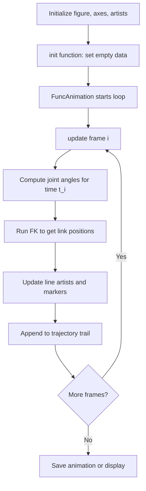
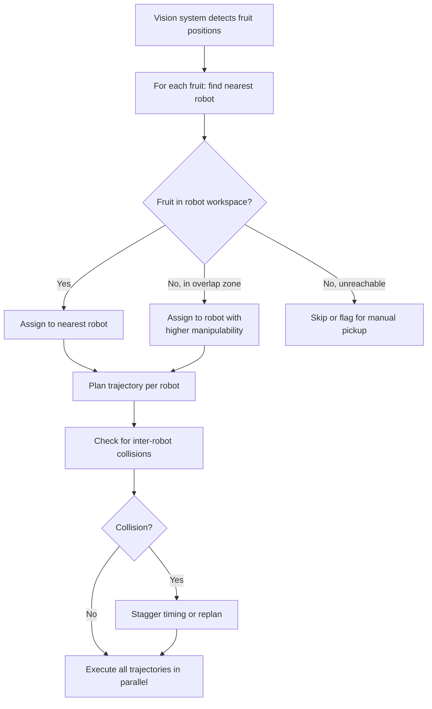

import RoboticsComments from '../../../../components/robotics/RoboticsComments.astro';
import TawkWidget from '../../../../components/TawkWidget.astro';
import UniversalContentContributors from '../../../../components/UniversalContentContributors.astro';
import InArticleAd from '../../../../components/InArticleAd.astro';
import Copyright from '../../../../components/Copyright.astro';
import BionicText from '../../../../components/BionicText.astro';
import TailwindWrapper from '../../../../components/TailwindWrapper.jsx';
import { Tabs, TabItem } from '@astrojs/starlight/components';
import { Card, CardGrid, Badge, Steps, LinkButton, FileTree } from '@astrojs/starlight/components';

<UniversalContentContributors 
  contributors={frontmatter.contributors}
/>


On the screen, three robot arms pick strawberries in 3 seconds each and never touch. In the greenhouse, the first real arm arrives late and misses the fruit by 25 mm. The simulation did not lie about itself. It was never compared with the world. A simulation is a model, and a model that only agrees with itself proves nothing. This lesson builds a Python simulator for a two-joint arm from the kinematics, the Jacobian and the trajectories of this course, runs a harvesting cell of three arms in it, and shows how to check it: against a case solved by hand, and against one measurement on the machine. #RobotSimulation #PythonVisualization #AppliedRobotics

## Learning Objectives

By the end of this lesson, you will be able to:

1. **Build** simulation framework combining FK, IK, Jacobian, and trajectory planning into one Python class
2. **Animate** robot motion using matplotlib FuncAnimation with real-time arm rendering and trajectory trails
3. **Implement** safety systems including joint limits, singularity avoidance, and workspace boundaries
4. **Design** multi-robot coordination for agricultural harvesting with collision-free task allocation
5. **Apply** robotics principles across manufacturing, logistics, medical, and agricultural domains

## Real-World Engineering Challenge: Multi-Robot Agricultural Harvesting System

<InArticleAd />


A farm wants to harvest ripe strawberries in a greenhouse row with three robot arms on a gantry, a rail above the row. Each arm is a 2R planar arm: two links joined by two revolute (turning) joints, a shoulder and an elbow, moving in one plane. A camera system gives the position of each ripe fruit. Each arm must reach a fruit, pick it, and place it in its collection bin, and no two arms may collide where their reach overlaps.

### System Description

- **Three 2R planar arms** at fixed bases along the gantry rail
- **A shared region** where the reach of two neighboring arms overlaps
- **A vision system** that gives the (x, y) position of each ripe fruit, in meters
- **A collection bin** at the base of each arm
- **A cycle time target** of 3 seconds per fruit (reach, pick, place, return)

### The Simulation Challenge

:::note[Critical Engineering Questions]
- How do the pieces of this course fit into one simulation loop? The pieces are forward kinematics (FK: joint angles to gripper position), inverse kinematics (IK: gripper position to joint angles), the Jacobian (joint velocities to gripper velocity) and trajectory planning.
- Which arm should pick which fruit?
- What happens when two arms reach into the shared region at the same time?
- Which checks stop an arm from passing a joint limit or entering a singular pose, where it loses a direction of motion?
- How far can the result be trusted before a real arm has moved?
:::

### Why Agricultural Robotics Is a Growing Field

Farms in many countries cannot find enough workers at harvest time. Strawberries are a hard case for a robot: the fruit is soft, partly hidden by leaves, and does not ripen all at once. A mistake on a real plant costs fruit, so the motion is tried in simulation first.

### Consequences of Poor Simulation Design

A simulation finds some faults cheaply, before any hardware moves:

- two arms that cross in the shared region
- a pose near a singularity, where joint velocities become very large
- one arm with most of the fruit while another waits
- a target outside the reach of every arm

It cannot find a fault in something it does not contain. A simulator with no motor model shows an arm that moves at any speed. A simulator with a wrong link length reaches every target perfectly, in the wrong place.

## Fundamental Theory

<InArticleAd />


### Simulation vs. Animation

A simulation calculates the state of the robot (joint angles, velocities, gripper position) at each time step from equations. An animation only draws pictures, one frame after another. In robotics the simulation comes first, and the animation draws what the simulation calculated. A smooth animation therefore says nothing about whether the equations behind it are right.

<Tabs>
<TabItem label="Simulation">

**What it does:** Calculates the state of the robot at each time step from the kinematic equations.

**Key characteristics:**
- Stepped in time: the state at time $t_{k+1}$ follows from the state at $t_k$
- Based on equations: FK, IK, the Jacobian and the trajectory formulas of this course
- Repeatable: the same inputs always give the same outputs
- Checks limits: joint limits, singularities, the edge of the workspace

**One time step:** the new joint angles are the old angles plus the joint velocity multiplied by the time step.

$$
\mathbf{q}(t_{k+1}) = \mathbf{q}(t_k) + \dot{\mathbf{q}}(t_k) \cdot \Delta t
$$

Here $\mathbf{q}$ is the list of joint angles (rad), $\dot{\mathbf{q}}$ is the list of joint velocities (rad/s), and $\Delta t$ is the time step (s).

</TabItem>
<TabItem label="Animation">

**What it does:** Draws the robot at each frame from the simulation data.

**Key characteristics:**
- Runs at a fixed display rate (for example 30 frames per second, FPS)
- Draws only: it calculates no motion
- May fill in between simulation steps for a smoother picture
- Here it uses matplotlib `FuncAnimation` to draw a 2D arm

**Animation loop:**

$$
\text{frame}_i \rightarrow \text{read } \mathbf{q}(t_i) \rightarrow \text{compute FK} \rightarrow \text{draw links and joints}
$$

</TabItem>
</Tabs>

### Building a Robot Simulation Framework in Python

The simulator is one Python class that holds the model of the arm, its present state, the safety checks and the drawing. A class keeps these together, so that three arms are three copies of the same code.

#### Robot Class Architecture

The class has four parts:

<Steps>
1. **Kinematic model**
   It stores the link lengths $L_1$ and $L_2$ (in meters) and calculates FK, IK and the Jacobian, with the equations of [Forward and Inverse Kinematics](/education/robotics/forward-inverse-kinematics/) and [Velocity Kinematics and the Jacobian](/education/robotics/velocity-kinematics-jacobian/).

2. **State**
   It keeps the present joint angles $\mathbf{q} = [\theta_1, \theta_2]^T$, the joint velocities $\dot{\mathbf{q}}$, and the position $\mathbf{p} = [x, y]^T$ of the end-effector (the gripper at the tip of the arm).

3. **Safety checks**
   It keeps each joint inside its limits $[\theta_{\min}, \theta_{\max}]$, warns near a singular pose ($\det(J) \approx 0$), and refuses a target outside the workspace, the region the gripper can reach.

4. **Drawing**
   It draws the arm, the trail of the gripper, the edge of the workspace and the safety zones with matplotlib.
</Steps>

#### Forward Kinematics

FK answers: with these joint angles, where is the gripper? The shoulder angle $\theta_1$ is measured from the x-axis. The elbow angle $\theta_2$ is measured from the direction of the first link. Add the reach of the first link to the reach of the second:

$$
x = L_1 \cos(\theta_1) + L_2 \cos(\theta_1 + \theta_2)
$$

$$
y = L_1 \sin(\theta_1) + L_2 \sin(\theta_1 + \theta_2)
$$

**Check by hand.** The arm of this lesson has $L_1 = 1.0$ m and $L_2 = 0.8$ m. Two poses need no calculator. Straight out along x ($\theta_1 = 0$, $\theta_2 = 0$): the gripper must be at $(1.0 + 0.8,\; 0) = (1.8,\; 0)$. Elbow bent at a right angle ($\theta_1 = 0$, $\theta_2 = 90°$): the first link lies along x and the second points up, so the gripper must be at $(1.0,\; 0.8)$. The formulas give $x = 1.0\cos 0° + 0.8\cos 90° = 1.0$ and $y = 1.0\sin 0° + 0.8\sin 90° = 0.8$. Run these two poses through any FK code before you trust it.

#### Inverse Kinematics

IK answers the opposite question: to put the gripper at a target $(x_t, y_t)$, which joint angles are needed? The law of cosines gives the elbow angle, and the shoulder angle follows:

$$
\cos(\theta_2) = \frac{x_t^2 + y_t^2 - L_1^2 - L_2^2}{2 L_1 L_2}
$$

$$
\theta_2 = \text{atan2}\!\left(\pm\sqrt{1 - \cos^2(\theta_2)},\; \cos(\theta_2)\right)
$$

$$
\theta_1 = \text{atan2}(y_t, x_t) - \text{atan2}\!\left(L_2 \sin(\theta_2),\; L_1 + L_2 \cos(\theta_2)\right)
$$

The $\pm$ sign gives two answers, elbow up and elbow down, which reach the same point.

#### Jacobian Matrix

The Jacobian $J$ converts joint velocities to the velocity of the gripper, $\dot{\mathbf{p}} = J(\mathbf{q}) \, \dot{\mathbf{q}}$:

$$
J = \begin{bmatrix}
-L_1 \sin(\theta_1) - L_2 \sin(\theta_1 + \theta_2) & -L_2 \sin(\theta_1 + \theta_2) \\
L_1 \cos(\theta_1) + L_2 \cos(\theta_1 + \theta_2) & L_2 \cos(\theta_1 + \theta_2)
\end{bmatrix}
$$

Its determinant is $\det(J) = L_1 L_2 \sin(\theta_2)$. It is zero when $\theta_2 = 0$ or $\theta_2 = \pi$ (arm fully straight or fully folded). These poses are the singularities: the gripper cannot move along the line of the arm, whatever the joints do. The size of the determinant, $|\det(J)|$, is called the manipulability. For this arm it is at most $1.0 \times 0.8 = 0.8$, at a right-angle elbow, and it falls to zero at a singularity.

### Visualization with matplotlib

The matplotlib class `FuncAnimation` runs the animation. It calls an update function once per frame, and that function redraws the arm, the trail of the gripper and the edge of the workspace.

#### FuncAnimation Usage



The animation loop follows this structure:

```python
import matplotlib.pyplot as plt
from matplotlib.animation import FuncAnimation

fig, ax = plt.subplots(figsize=(10, 10))

def init():
    """Set up the plot elements (called once)."""
    ax.set_xlim(-3, 3)
    ax.set_ylim(-3, 3)
    ax.set_aspect('equal')
    ax.grid(True, alpha=0.3)
    return []

def update(frame):
    """Update robot state and redraw (called every frame)."""
    # 1. Advance simulation state
    # 2. Compute FK for current joint angles
    # 3. Redraw arm links and joints
    # 4. Update trajectory trail
    return [arm_line, joint_dots, trail_line]

anim = FuncAnimation(fig, update, init_func=init,
                     frames=num_frames, interval=33, blit=True)
plt.show()
```

:::note[Key Animation Parameters]
- `frames`: the number of frames, which sets how long the animation runs
- `interval`: milliseconds between frames (33 ms gives about 30 FPS)
- `blit=True`: redraw only what changed, which is faster
- The `update` function must return a list of the matplotlib artists (the drawn objects) that it changed
:::

#### Real-Time Arm Rendering

Each frame redraws the robot arm as connected line segments:

```python
def draw_arm(ax, theta1, theta2, L1, L2):
    """Draw 2R arm from base to end-effector."""
    # Joint positions
    x0, y0 = 0.0, 0.0  # base
    x1 = L1 * np.cos(theta1)
    y1 = L1 * np.sin(theta1)
    x2 = x1 + L2 * np.cos(theta1 + theta2)
    y2 = y1 + L2 * np.sin(theta1 + theta2)

    # Draw links
    arm_x = [x0, x1, x2]
    arm_y = [y0, y1, y2]
    arm_line.set_data(arm_x, arm_y)

    # Draw joints as circles
    joints.set_data([x0, x1, x2], [y0, y1, y2])

    return x2, y2  # end-effector position
```

#### Trajectory Trails

Appending the end-effector position at each frame creates a trajectory trail:

```python
trail_x, trail_y = [], []

def update_trail(ex, ey, max_points=200):
    """Add end-effector position to trail, trim to max length."""
    trail_x.append(ex)
    trail_y.append(ey)
    if len(trail_x) > max_points:
        trail_x.pop(0)
        trail_y.pop(0)
    trail_line.set_data(trail_x, trail_y)
```

#### Workspace Overlay

The workspace of a 2R arm is a ring (an annulus). The gripper reaches no farther than $L_1 + L_2$ from the base and no nearer than $|L_1 - L_2|$:

```python
def draw_workspace(ax, L1, L2, base_x=0, base_y=0):
    """Draw inner and outer workspace boundaries."""
    theta = np.linspace(0, 2 * np.pi, 100)

    # Outer boundary: L1 + L2
    r_outer = L1 + L2
    ax.plot(base_x + r_outer * np.cos(theta),
            base_y + r_outer * np.sin(theta),
            'g--', alpha=0.3, linewidth=1)

    # Inner boundary: |L1 - L2|
    r_inner = abs(L1 - L2)
    if r_inner > 0.01:
        ax.plot(base_x + r_inner * np.cos(theta),
                base_y + r_inner * np.sin(theta),
                'r--', alpha=0.3, linewidth=1)
```

### Complete 2R Robot Simulator

The class below is the whole simulator for one arm: FK, IK with the choice of elbow up or down, the Jacobian with a singularity warning, the cubic trajectory, and the joint limits. The harvesting cell later uses three copies of it. Note what it does not contain: no motor, no mass, no friction. An arm in this class moves as fast as the plan asks.

```python
import numpy as np
import matplotlib.pyplot as plt
from matplotlib.animation import FuncAnimation
from matplotlib.patches import Circle

class Robot2R:
    """Complete 2R planar robot simulator.

    Combines FK, IK, Jacobian, and trajectory planning from the
    earlier lessons into one simulation class.
    """

    def __init__(self, L1=1.0, L2=0.8, base=(0.0, 0.0),
                 joint_limits=((-np.pi, np.pi), (-np.pi + 0.1, np.pi - 0.1))):
        # Link parameters
        self.L1 = L1
        self.L2 = L2
        self.base = np.array(base)

        # Joint limits: [(theta1_min, theta1_max), (theta2_min, theta2_max)]
        self.joint_limits = joint_limits

        # Current state
        self.q = np.array([0.0, 0.0])   # joint angles [theta1, theta2]
        self.qd = np.array([0.0, 0.0])  # joint velocities

        # Workspace bounds
        self.r_outer = L1 + L2
        self.r_inner = abs(L1 - L2)

        # Trajectory storage
        self.trail_x = []
        self.trail_y = []

        # Singularity threshold
        self.singularity_threshold = 0.05

    # ---- Kinematics (Lessons 1 and 2) ----

    def forward_kinematics(self, q=None):
        """Compute end-effector position from joint angles."""
        if q is None:
            q = self.q
        t1, t2 = q
        # Elbow position
        x1 = self.base[0] + self.L1 * np.cos(t1)
        y1 = self.base[1] + self.L1 * np.sin(t1)
        # End-effector position
        x2 = x1 + self.L2 * np.cos(t1 + t2)
        y2 = y1 + self.L2 * np.sin(t1 + t2)
        return np.array([x2, y2]), np.array([x1, y1])

    def inverse_kinematics(self, target, elbow_up=True):
        """Solve IK for target (x, y). Returns joint angles or None."""
        px = target[0] - self.base[0]
        py = target[1] - self.base[1]
        r_sq = px**2 + py**2
        r = np.sqrt(r_sq)

        # Workspace check
        if r > self.r_outer - 0.01 or r < self.r_inner + 0.01:
            return None  # outside reachable workspace

        cos_t2 = (r_sq - self.L1**2 - self.L2**2) / (2 * self.L1 * self.L2)
        cos_t2 = np.clip(cos_t2, -1.0, 1.0)

        sin_t2 = np.sqrt(1 - cos_t2**2)
        if not elbow_up:
            sin_t2 = -sin_t2

        t2 = np.arctan2(sin_t2, cos_t2)
        t1 = np.arctan2(py, px) - np.arctan2(
            self.L2 * sin_t2, self.L1 + self.L2 * cos_t2
        )

        q_sol = np.array([t1, t2])

        # Joint limit check
        if not self._check_joint_limits(q_sol):
            return None

        return q_sol

    # ---- Jacobian ----

    def jacobian(self, q=None):
        """Compute 2x2 Jacobian matrix."""
        if q is None:
            q = self.q
        t1, t2 = q
        s1 = np.sin(t1)
        c1 = np.cos(t1)
        s12 = np.sin(t1 + t2)
        c12 = np.cos(t1 + t2)

        J = np.array([
            [-self.L1 * s1 - self.L2 * s12, -self.L2 * s12],
            [ self.L1 * c1 + self.L2 * c12,  self.L2 * c12]
        ])
        return J

    def manipulability(self, q=None):
        """Compute manipulability measure: |det(J)|."""
        J = self.jacobian(q)
        return abs(np.linalg.det(J))

    def is_near_singularity(self, q=None):
        """Check if configuration is near a singularity."""
        return self.manipulability(q) < self.singularity_threshold

    # ---- Trajectory Planning ----

    def cubic_trajectory(self, q_start, q_end, num_steps):
        """Generate cubic polynomial trajectory in joint space.

        Boundary conditions: zero velocity at start and end.
        q(t) = a0 + a1*t + a2*t^2 + a3*t^3, t in [0, 1]
        With q(0)=q_start, q(1)=q_end, qd(0)=0, qd(1)=0:
            a0 = q_start, a1 = 0, a2 = 3*(q_end-q_start), a3 = -2*(q_end-q_start)
        """
        trajectory = []
        for i in range(num_steps):
            t = i / max(num_steps - 1, 1)
            # Cubic with zero-velocity endpoints
            s = 3 * t**2 - 2 * t**3
            q = q_start + s * (q_end - q_start)
            trajectory.append(q.copy())
        return trajectory

    def plan_pick_and_place(self, pick_pos, place_pos, home_q=None,
                            steps_per_segment=30):
        """Plan a complete pick-and-place trajectory.

        Sequence: home -> pick -> (lift) -> place -> home
        """
        if home_q is None:
            home_q = np.array([np.pi / 4, np.pi / 4])

        q_pick = self.inverse_kinematics(pick_pos)
        q_place = self.inverse_kinematics(place_pos)

        if q_pick is None or q_place is None:
            return None  # unreachable target

        # Build trajectory segments
        traj = []
        traj += self.cubic_trajectory(home_q, q_pick, steps_per_segment)
        traj += self.cubic_trajectory(q_pick, q_place, steps_per_segment)
        traj += self.cubic_trajectory(q_place, home_q, steps_per_segment)

        return traj

    # ---- Safety and Constraints ----

    def _check_joint_limits(self, q):
        """Return True if all joints are within limits."""
        for i, (lo, hi) in enumerate(self.joint_limits):
            if q[i] < lo or q[i] > hi:
                return False
        return True

    def clamp_joints(self, q):
        """Clamp joint angles to their limits."""
        q_clamped = q.copy()
        for i, (lo, hi) in enumerate(self.joint_limits):
            q_clamped[i] = np.clip(q[i], lo, hi)
        return q_clamped

    def is_in_workspace(self, target):
        """Check if a target position is within the reachable workspace."""
        dx = target[0] - self.base[0]
        dy = target[1] - self.base[1]
        r = np.sqrt(dx**2 + dy**2)
        return self.r_inner < r < self.r_outer

    # ---- State Update ----

    def set_configuration(self, q):
        """Set joint angles (with limit enforcement)."""
        self.q = self.clamp_joints(q)
        ee, _ = self.forward_kinematics()
        self.trail_x.append(ee[0])
        self.trail_y.append(ee[1])

    def reset_trail(self):
        """Clear the trajectory trail."""
        self.trail_x = []
        self.trail_y = []
```

:::note[Design Decisions in the Simulator Class]
- **Workspace check in IK:** it returns `None`, not a wrong answer, when the target cannot be reached. The code that calls it must test for `None`.
- **Joint clamping:** an angle beyond a limit is cut back to the limit. A real controller would also slow the joint before the limit.
- **Singularity threshold:** the arm counts as near a singularity when $|\det(J)|$ is below 0.05. The right value depends on the link lengths and on the margin you want.
- **Cubic trajectory:** each joint starts and stops at rest, as in [Trajectory Planning and Motion Control](/education/robotics/trajectory-planning-motion-control/). The trajectory is a list of positions with no time attached. The time comes later, from the frame interval of the animation.
:::

### Animated Pick-and-Place Demonstration

This script animates one arm. It plans a move from the home configuration (the waiting pose) to a pick position, then to a place position, and back.

```python
import numpy as np
import matplotlib.pyplot as plt
from matplotlib.animation import FuncAnimation

# Create robot
robot = Robot2R(L1=1.0, L2=0.8, base=(0.0, 0.0))

# Define pick-and-place task
pick_position = np.array([1.2, 0.8])
place_position = np.array([-0.5, 1.0])
home_angles = np.array([np.pi / 4, np.pi / 4])

# Plan trajectory
trajectory = robot.plan_pick_and_place(
    pick_position, place_position,
    home_q=home_angles, steps_per_segment=40
)

if trajectory is None:
    print("Error: one or more targets are unreachable.")
else:
    # Set up figure
    fig, ax = plt.subplots(1, 1, figsize=(8, 8))
    ax.set_xlim(-2.5, 2.5)
    ax.set_ylim(-2.5, 2.5)
    ax.set_aspect('equal')
    ax.grid(True, alpha=0.3)
    ax.set_title('2R Robot Pick-and-Place Simulation')
    ax.set_xlabel('x (m)')
    ax.set_ylabel('y (m)')

    # Draw workspace boundary
    theta_ws = np.linspace(0, 2 * np.pi, 200)
    ax.plot(robot.r_outer * np.cos(theta_ws),
            robot.r_outer * np.sin(theta_ws),
            'g--', alpha=0.3, linewidth=1, label='Outer workspace')
    ax.plot(robot.r_inner * np.cos(theta_ws),
            robot.r_inner * np.sin(theta_ws),
            'r--', alpha=0.3, linewidth=1, label='Inner workspace')

    # Mark pick and place locations
    ax.plot(*pick_position, 'rv', markersize=12, label='Pick')
    ax.plot(*place_position, 'bs', markersize=12, label='Place')

    # Initialize plot elements
    arm_line, = ax.plot([], [], 'o-', color='#2c3e50', linewidth=3,
                        markersize=8, markerfacecolor='#e74c3c')
    trail_line, = ax.plot([], [], '-', color='#3498db', linewidth=1.5,
                          alpha=0.6)
    frame_text = ax.text(-2.3, 2.2, '', fontsize=10)

    ax.legend(loc='upper right')

    robot.reset_trail()
    robot.set_configuration(home_angles)

    def update(frame):
        q = trajectory[frame]
        robot.set_configuration(q)

        ee, elbow = robot.forward_kinematics()
        base = robot.base

        arm_line.set_data([base[0], elbow[0], ee[0]],
                          [base[1], elbow[1], ee[1]])
        trail_line.set_data(robot.trail_x, robot.trail_y)

        # Label the phase
        steps = 40
        if frame < steps:
            phase = 'Moving to Pick'
        elif frame < 2 * steps:
            phase = 'Moving to Place'
        else:
            phase = 'Returning Home'
        frame_text.set_text(f'Frame {frame}/{len(trajectory)-1}  |  {phase}')

        return [arm_line, trail_line, frame_text]

    anim = FuncAnimation(fig, update, frames=len(trajectory),
                         interval=50, blit=True, repeat=True)
    plt.tight_layout()
    plt.show()
```

<details>
<summary>Expected output and what to observe</summary>

When you run this script, a matplotlib window opens showing:

1. **Green dashed circle:** the outer workspace boundary ($L_1 + L_2 = 1.8$ m)
2. **Red dashed circle:** the inner workspace boundary ($|L_1 - L_2| = 0.2$ m)
3. **Red triangle:** the pick location
4. **Blue square:** the place location
5. **Dark arm with red joints:** the 2R robot arm moving through the pick-and-place sequence
6. **Blue trail:** the path traced by the end-effector

The arm starts at the home configuration, moves to the pick position, then to the place position, and returns home. Each segment starts and ends gently, because the cubic trajectory has zero velocity at both ends.

Each segment has 40 frames at 50 ms, so it lasts about 2 s. The largest joint move is the shoulder between pick and place, $71.2°$. A cubic has a peak velocity of 1.5 times the average, so the simulator asks that joint for $1.5 \times 71.2 / 2 = 53$ deg/s. Whether a real motor can give that is a question the simulator does not ask.

</details>

### Workspace Visualization with Safety Zones

```python
import numpy as np
import matplotlib.pyplot as plt

def visualize_workspace_safety(robot, resolution=200):
    """Visualize workspace with manipulability heat map and safety zones."""
    fig, ax = plt.subplots(figsize=(9, 9))

    # Sample the workspace on a grid
    x_range = np.linspace(-robot.r_outer - 0.2, robot.r_outer + 0.2, resolution)
    y_range = np.linspace(-robot.r_outer - 0.2, robot.r_outer + 0.2, resolution)
    manip_map = np.full((resolution, resolution), np.nan)

    for i, x in enumerate(x_range):
        for j, y in enumerate(y_range):
            target = np.array([x, y])
            q_sol = robot.inverse_kinematics(target)
            if q_sol is not None:
                manip_map[j, i] = robot.manipulability(q_sol)

    # Plot manipulability heat map
    im = ax.imshow(manip_map, extent=[x_range[0], x_range[-1],
                                       y_range[0], y_range[-1]],
                   origin='lower', cmap='viridis', alpha=0.7)
    plt.colorbar(im, ax=ax, label='Manipulability |det(J)|')

    # Overlay workspace boundaries
    theta = np.linspace(0, 2 * np.pi, 200)
    bx, by = robot.base
    ax.plot(bx + robot.r_outer * np.cos(theta),
            by + robot.r_outer * np.sin(theta),
            'w--', linewidth=1.5, label='Outer boundary')
    if robot.r_inner > 0.01:
        ax.plot(bx + robot.r_inner * np.cos(theta),
                by + robot.r_inner * np.sin(theta),
                'r--', linewidth=1.5, label='Inner boundary (singularity zone)')

    # Safety margin zone (90% of outer boundary)
    r_safe = 0.9 * robot.r_outer
    ax.plot(bx + r_safe * np.cos(theta),
            by + r_safe * np.sin(theta),
            'orange', linewidth=1.5, linestyle=':', label='Safety margin (90%)')

    # Mark base
    ax.plot(bx, by, 'w^', markersize=14)

    ax.set_xlim(x_range[0], x_range[-1])
    ax.set_ylim(y_range[0], y_range[-1])
    ax.set_aspect('equal')
    ax.set_xlabel('x (m)')
    ax.set_ylabel('y (m)')
    ax.set_title('Workspace Manipulability Map with Safety Zones')
    ax.legend(loc='upper right', fontsize=9)
    ax.grid(True, alpha=0.2, color='white')
    plt.tight_layout()
    plt.show()

# Usage
robot = Robot2R(L1=1.0, L2=0.8)
visualize_workspace_safety(robot, resolution=150)
```

:::note[Reading the Manipulability Map]
- **Bright (yellow) regions:** high manipulability. The gripper can move easily in every direction. Do exact work here.
- **Dark (purple) regions:** low manipulability, close to a singularity. Joint velocities can become very large. Do not work here for long.
- **Empty (transparent) regions:** outside the workspace. The program marks them NaN, "not a number".
- **Orange dotted circle:** 90% of the full reach. A gripper kept inside it stays away from the singularity at the outer edge.
:::

### Practical Applications of Robotics

The same four tools serve every field below: FK to predict a position, IK to reach a target, the Jacobian to control velocity, and trajectory planning for motion the motors can make. Only the requirements change.

<CardGrid>
  <Card title="Manufacturing" icon="setting">
    **Assembly Lines:** Robots place components with sub-millimeter precision using IK to reach exact mounting positions and trajectory planning for repeatable cycle times.

    **Welding:** Seam tracking requires real-time Jacobian-based velocity control to maintain consistent torch speed along curved weld paths.

    **Painting:** Spray robots follow complex surface contours using task-space trajectory planning with orientation control (quaternions applied to 6-DOF arms).

    **Key metrics:** cycle time, positioning repeatability, throughput
  </Card>

  <Card title="Logistics and Warehousing" icon="rocket">
    **Warehouse Sorting:** Pick-and-place robots sort thousands of packages per hour, using IK to reach varying bin positions and cubic trajectories for gentle handling.

    **Palletizing:** Stacking robots plan layer patterns and compute IK solutions for each placement position, adjusting for pallet height as layers build up.

    **Order Picking:** Mobile manipulators combine navigation with arm kinematics to retrieve items from shelving, requiring workspace analysis for reach planning.

    **Key metrics:** picks per hour, error rate, package damage rate
  </Card>

  <Card title="Medical Robotics" icon="heart">
    **Surgical Systems (e.g., da Vinci):** Teleoperated arms use Jacobian-based resolved-rate control so surgeons can command end-effector velocity in task space while the system computes joint velocities.

    **Rehabilitation:** Exoskeleton robots guide patient limbs along therapeutic trajectories using joint-space interpolation with force limits for safety.

    **Pharmacy Automation:** Dispensing robots use precise IK solutions to pick medications from storage bins and place them in patient trays with zero-error requirements.

    **Key metrics:** positioning accuracy, force limits, safety redundancy
  </Card>

  <Card title="Agriculture" icon="sun">
    **Harvesting:** Robots identify ripe fruit with vision systems and use IK to reach each fruit position. Gentle cubic trajectories prevent bruising.

    **Planting:** Seed placement robots compute IK for precise soil positions along pre-planned rows, maintaining consistent depth and spacing.

    **Crop Monitoring:** Arms mounted on rovers extend sensors into crop canopies, using workspace analysis to determine which plants are reachable from each rover position.

    **Key metrics:** harvest rate, fruit damage rate, field coverage
  </Card>

</CardGrid>

Food packaging, quality inspection and the 3D printing of buildings use the same tools.

### Error Handling and Safety

A simulation must test four things at every time step: the joint limits, the distance from a singularity, the edge of the workspace, and collisions. In the simulation these tests stop impossible states. On a real arm the same tests prevent damage and injury.

#### Joint Limit Checking

Every joint has a range it can turn through. Beyond it, gears, belts or the motor can be damaged.

```python
def enforce_joint_limits(q, limits):
    """Clamp angles and return violation flag."""
    q_safe = q.copy()
    violated = False
    for i, (lo, hi) in enumerate(limits):
        if q[i] < lo:
            q_safe[i] = lo
            violated = True
        elif q[i] > hi:
            q_safe[i] = hi
            violated = True
    return q_safe, violated
```

:::note[Joint Limit Strategy]
In simulation it is enough to clamp the angle. On a real arm, slow the joint before it reaches the limit: watch the distance to the limit and reduce the velocity as that distance shrinks.
:::

#### Singularity Avoidance

To move the gripper at a wanted velocity, the controller divides by $\det(J)$. When $\det(J)$ is close to zero, a small gripper velocity asks for a very large joint velocity.

```python
def singularity_safe_ik_velocity(J, v_desired, threshold=0.05, damping=0.1):
    """Damped least-squares inverse for singularity-robust velocity control.

    Instead of: qd = J_inv @ v_desired  (which blows up near singularity)
    Use: qd = J^T @ (J @ J^T + lambda^2 * I)^-1 @ v_desired
    """
    det_J = abs(np.linalg.det(J))
    if det_J < threshold:
        # Apply damping near singularity
        lam = damping * (1 - det_J / threshold)
        JJT = J @ J.T + lam**2 * np.eye(2)
        qd = J.T @ np.linalg.solve(JJT, v_desired)
    else:
        # Normal inverse
        qd = np.linalg.solve(J, v_desired)
    return qd
```

### Why Damped Least-Squares Works

The damped least-squares method (also called Levenberg-Marquardt) adds a small positive number, $\lambda^2$, to the diagonal of the matrix $J J^T$ before it is inverted. The sum can always be inverted, even exactly at a singularity, so the joint velocities stay limited.

The price is accuracy: near a singularity the gripper moves a little off the direction that was asked. In the code, the damping factor $\lambda$ is zero away from a singularity and grows as the manipulability falls, so the error appears only where the protection is needed. The method was introduced in [Velocity Kinematics and the Jacobian](/education/robotics/velocity-kinematics-jacobian/).

#### Workspace Boundary Enforcement

A target outside the ring of the workspace must be refused, or moved to the nearest point the arm can reach.

```python
def project_to_workspace(target, base, r_inner, r_outer, margin=0.05):
    """Project an out-of-workspace target onto the nearest reachable point."""
    d = target - base
    r = np.linalg.norm(d)

    if r < 1e-10:
        # Target is at the base; project to inner boundary
        return base + np.array([r_inner + margin, 0.0])

    direction = d / r

    if r > r_outer - margin:
        return base + direction * (r_outer - margin)
    elif r < r_inner + margin:
        return base + direction * (r_inner + margin)
    else:
        return target  # already inside workspace
```

#### Collision Detection Basics

With several arms, test whether any link of one arm crosses any link of another. Each link is treated as a straight line segment with no thickness, so a real cell needs a margin on top of this test.

```python
def segments_intersect(p1, p2, p3, p4):
    """Check if line segment (p1,p2) intersects segment (p3,p4).

    Uses the cross-product orientation method.
    """
    def cross2d(a, b):
        return a[0] * b[1] - a[1] * b[0]

    d1 = p2 - p1
    d2 = p4 - p3

    denom = cross2d(d1, d2)
    if abs(denom) < 1e-10:
        return False  # parallel segments

    t = cross2d(p3 - p1, d2) / denom
    u = cross2d(p3 - p1, d1) / denom

    return 0 <= t <= 1 and 0 <= u <= 1

def check_robot_collision(robot_a, robot_b):
    """Check if any links of two robots intersect."""
    ee_a, elbow_a = robot_a.forward_kinematics()
    ee_b, elbow_b = robot_b.forward_kinematics()

    # Robot A segments: base->elbow, elbow->ee
    seg_a = [(robot_a.base, elbow_a), (elbow_a, ee_a)]
    # Robot B segments: base->elbow, elbow->ee
    seg_b = [(robot_b.base, elbow_b), (elbow_b, ee_b)]

    for (a1, a2) in seg_a:
        for (b1, b2) in seg_b:
            if segments_intersect(a1, a2, b1, b2):
                return True
    return False
```

## System Application: Multi-Robot Agricultural Harvesting

<InArticleAd />


Three 2R arms stand 2.0 m apart along the gantry. Each reaches 1.8 m, so the workspaces of neighbors overlap. The vision system gives a list of fruit positions. The simulation gives each fruit to an arm, plans the moves, tests every frame for a collision between arms, and animates the result.



### Task Allocation Strategy

For each fruit, the program gives a score to every arm that can reach it: the manipulability at that point divided by the distance from the base of the arm. The fruit goes to the arm with the highest score. A near arm in a good pose wins. A fruit in the overlap between two arms goes to the one that reaches it more easily, and a fruit that no arm can reach is left out.

### Complete Multi-Robot Harvesting Simulation

```python
import numpy as np
import matplotlib.pyplot as plt
from matplotlib.animation import FuncAnimation

class HarvestingCell:
    """Multi-robot agricultural harvesting coordination system."""

    def __init__(self):
        # Three robots mounted along a gantry (spaced 2.0 m apart)
        self.robots = [
            Robot2R(L1=1.0, L2=0.8, base=(-2.0, 0.0)),
            Robot2R(L1=1.0, L2=0.8, base=(0.0, 0.0)),
            Robot2R(L1=1.0, L2=0.8, base=(2.0, 0.0)),
        ]
        self.colors = ['#e74c3c', '#2ecc71', '#3498db']
        self.names = ['Left Arm', 'Center Arm', 'Right Arm']

        # Collection bin positions (below each base)
        self.bins = [
            np.array([-2.0, -0.5]),
            np.array([0.0, -0.5]),
            np.array([2.0, -0.5]),
        ]

        # Home configurations
        self.home_angles = [
            np.array([np.pi / 3, np.pi / 4]),
            np.array([np.pi / 3, np.pi / 4]),
            np.array([np.pi / 3, np.pi / 4]),
        ]

    def allocate_fruit(self, fruit_positions):
        """Assign each fruit to the best robot.

        Strategy: nearest robot with highest manipulability.
        Returns dict: {robot_index: [list of fruit positions]}
        """
        assignments = {i: [] for i in range(len(self.robots))}

        for fruit in fruit_positions:
            best_robot = None
            best_score = -1

            for i, robot in enumerate(self.robots):
                if not robot.is_in_workspace(fruit):
                    continue

                q_sol = robot.inverse_kinematics(fruit)
                if q_sol is None:
                    continue

                # Score: manipulability / distance (prefer closer, more dexterous)
                manip = robot.manipulability(q_sol)
                dist = np.linalg.norm(fruit - robot.base)
                score = manip / (dist + 0.1)

                if score > best_score:
                    best_score = score
                    best_robot = i

            if best_robot is not None:
                assignments[best_robot].append(fruit)

        return assignments

    def plan_all_trajectories(self, assignments, steps_per_segment=25):
        """Plan pick-and-place trajectories for all robots."""
        all_trajectories = {}

        for robot_idx, fruits in assignments.items():
            robot = self.robots[robot_idx]
            home_q = self.home_angles[robot_idx]
            bin_pos = self.bins[robot_idx]

            full_traj = []
            current_q = home_q.copy()

            for fruit_pos in fruits:
                q_pick = robot.inverse_kinematics(fruit_pos)
                q_place = robot.inverse_kinematics(bin_pos)

                if q_pick is None or q_place is None:
                    continue  # skip unreachable fruit

                # Trajectory: current -> pick -> place -> home
                full_traj += robot.cubic_trajectory(
                    current_q, q_pick, steps_per_segment)
                full_traj += robot.cubic_trajectory(
                    q_pick, q_place, steps_per_segment)
                full_traj += robot.cubic_trajectory(
                    q_place, home_q, steps_per_segment)
                current_q = home_q.copy()

            all_trajectories[robot_idx] = full_traj

        return all_trajectories

    def animate(self, fruit_positions):
        """Run the full harvesting simulation with animation."""
        # Allocate and plan
        assignments = self.allocate_fruit(fruit_positions)
        trajectories = self.plan_all_trajectories(assignments)

        # Find max trajectory length (pad shorter ones)
        max_len = max(len(t) for t in trajectories.values()) if trajectories else 0
        if max_len == 0:
            print("No reachable fruit found.")
            return

        for idx in trajectories:
            traj = trajectories[idx]
            if 0 < len(traj) < max_len:
                # Pad with last configuration
                traj += [traj[-1]] * (max_len - len(traj))

        # Set up figure
        fig, ax = plt.subplots(figsize=(14, 8))
        ax.set_xlim(-4.5, 4.5)
        ax.set_ylim(-2.0, 3.0)
        ax.set_aspect('equal')
        ax.grid(True, alpha=0.2)
        ax.set_title('Multi-Robot Strawberry Harvesting Simulation', fontsize=14)
        ax.set_xlabel('x (m)')
        ax.set_ylabel('y (m)')

        # Draw workspace boundaries
        theta_ws = np.linspace(0, 2 * np.pi, 200)
        for i, robot in enumerate(self.robots):
            bx, by = robot.base
            ax.plot(bx + robot.r_outer * np.cos(theta_ws),
                    by + robot.r_outer * np.sin(theta_ws),
                    '--', color=self.colors[i], alpha=0.2, linewidth=1)

        # Draw fruit positions
        for fruit in fruit_positions:
            ax.plot(fruit[0], fruit[1], 'ro', markersize=8, alpha=0.5)

        # Draw bins
        for i, bin_pos in enumerate(self.bins):
            ax.add_patch(plt.Rectangle(
                (bin_pos[0] - 0.15, bin_pos[1] - 0.15), 0.3, 0.3,
                fill=True, facecolor=self.colors[i], alpha=0.3,
                edgecolor=self.colors[i], linewidth=2
            ))

        # Initialize arm lines and trails
        arm_lines = []
        trail_lines = []
        for i in range(len(self.robots)):
            line, = ax.plot([], [], 'o-', color=self.colors[i],
                           linewidth=3, markersize=7,
                           markerfacecolor='white',
                           markeredgecolor=self.colors[i],
                           label=self.names[i])
            trail, = ax.plot([], [], '-', color=self.colors[i],
                            linewidth=1, alpha=0.4)
            arm_lines.append(line)
            trail_lines.append(trail)
            self.robots[i].reset_trail()

        status_text = ax.text(-4.3, 2.7, '', fontsize=10, fontfamily='monospace')
        ax.legend(loc='upper right')

        # Initialize robots at home
        for i, robot in enumerate(self.robots):
            robot.set_configuration(self.home_angles[i])

        def update(frame):
            for i, robot in enumerate(self.robots):
                if frame < len(trajectories.get(i, [])):
                    q = trajectories[i][frame]
                    robot.set_configuration(q)

                ee, elbow = robot.forward_kinematics()
                base = robot.base

                arm_lines[i].set_data(
                    [base[0], elbow[0], ee[0]],
                    [base[1], elbow[1], ee[1]]
                )
                trail_lines[i].set_data(robot.trail_x, robot.trail_y)

            # Check for inter-robot collisions
            collision = ""
            for a in range(len(self.robots)):
                for b in range(a + 1, len(self.robots)):
                    if check_robot_collision(self.robots[a], self.robots[b]):
                        collision = "  ** COLLISION DETECTED **"

            fruits_per_robot = [len(assignments.get(i, []))
                               for i in range(len(self.robots))]
            status_text.set_text(
                f'Frame {frame}/{max_len-1}  |  '
                f'Fruit: {fruits_per_robot}{collision}'
            )

            return arm_lines + trail_lines + [status_text]

        anim = FuncAnimation(fig, update, frames=max_len,
                             interval=40, blit=True, repeat=True)
        plt.tight_layout()
        plt.show()

# ---- Run the simulation ----

# Generate fruit positions (scattered in the harvesting zone)
np.random.seed(42)
num_fruit = 12
fruit_x = np.random.uniform(-3.5, 3.5, num_fruit)
fruit_y = np.random.uniform(0.5, 1.8, num_fruit)
fruit_positions = [np.array([fx, fy]) for fx, fy in zip(fruit_x, fruit_y)]

# Create and run harvesting cell
cell = HarvestingCell()
cell.animate(fruit_positions)
```

<details>
<summary>What the simulation shows</summary>

The animation shows three arms (red, green, blue) along a horizontal gantry. Red dots in the upper half are strawberries. The colored squares below the bases are the collection bins.

Each arm reaches for a fruit, picks it, places it in the bin and returns home before the next fruit. The trails show the path of each gripper. The status line shows the frame number, the number of fruit given to each arm, and a warning if two arms cross.

With the seed 42, the arms receive 4, 2 and 5 fruit. That is 11 of the 12. The fruit near $(-0.88,\; 1.58)$ is 1.81 m from the nearest base, just beyond the 1.8 m reach, and the program leaves it out without a message. No frame reports a collision. That result holds for this set of fruit only: the program detects a collision but does nothing to avoid one.

Change the `fruit_positions` or the spacing of the arms and run it again. Put a fruit in the overlap between two arms to see which arm the score chooses.

</details>

:::caution[The 3-second cycle is not yet proven]
Each fruit takes three segments of 25 frames at 40 ms, so the animation shows 3 s per fruit, the target. Look at one segment. The left arm carries a fruit from $(-3.36,\; 0.88)$ to its bin, and its shoulder turns from $123.9°$ to $-142.4°$: a move of $266.3°$ in about 1 s. The peak velocity of a cubic is 1.5 times the average, $1.5 \times 266.3 / 1 = 399$ deg/s. Take a joint motor limited to 120 deg/s, the limit used in the trajectory-planning lesson. At top speed all the way it needs $266.3 / 120 = 2.2$ s for that one segment, and a cubic it can follow needs $1.5 \times 266.3 / 120 = 3.3$ s. The simulator reports no problem, because it contains no motor.
:::

## Design Guidelines for Building Stable Simulations

<InArticleAd />


<CardGrid>
  <Card title="Separate Simulation from Visualization" icon="setting">
    Let the simulation produce the trajectory (a list of joint angles) first, and let the animation only play it. Then you can save the trajectory, draw it another way, or run many cases with no drawing at all.
  </Card>

  <Card title="Always Check Feasibility Before Planning" icon="warning">
    Before you plan a move to a target, confirm three things: the target is inside the workspace, IK has an answer inside the joint limits, and the pose is not near a singularity. Then check the peak joint velocity of the planned move against the motor.
  </Card>

  <Card title="Use Smooth Trajectory Profiles" icon="approve-check">
    A cubic or quintic polynomial starts and stops at zero velocity, which spares the gears and the motor. Where segments join, the velocity must not jump. Never command a sudden step in a joint angle.
  </Card>

  <Card title="Implement Collision Checking for Multi-Robot" icon="danger">
    Where arms share space, test every link of each arm against every link of the others at every time step. Real cells use tested libraries for this: **FCL** (Flexible Collision Library, used by MoveIt), **Bullet** (used by Gazebo and PyBullet) and **ODE**. They handle real link shapes and many obstacles far better than code written by hand.
  </Card>

  <Card title="Scale Simulations Incrementally" icon="rocket">
    Start with one arm and one pick-and-place, and check it by hand. Add a second arm and test the collision check. Only then run the full cell. A fault in a cell of three arms is much harder to find than a fault in one arm.
  </Card>
</CardGrid>

## Bridging to Real Robots

<InArticleAd />


The simulator of this lesson treats the arm as ideal: exact link lengths, joints that go where they are told, motors with no limit. A real arm is none of these.

### The Sim-to-Real Gap

A real motor has friction, and a top speed. Gearboxes have backlash, a small free play of some tenths of a degree when the direction reverses. A load bends the arm by millimeters. Sensors drift, and messages arrive late. None of this is in the Python model, so a trajectory that is perfect on the screen can miss by centimeters on the machine.

A common false comfort is the round trip: give a target to IK, give the angles to FK, and get the target back to six decimal places. This shows only that the two functions agree with each other. If both use $L_2 = 0.80$ m and the real link is 0.79 m, the round trip is still perfect and the real gripper is 10 mm away. Check the model against something outside it, in two steps:

<Steps>
1. **A case solved by hand.** Use a pose where the answer is plain from the geometry, such as the two FK poses above, or a move whose end is known. This finds errors in the code: a wrong sign, degrees mixed with radians, the two links exchanged.

2. **One measurement on the machine.** Command one pose and measure where the gripper is with a ruler, or time one move with a stopwatch. This finds errors in the numbers. For the pick position $(1.2,\; 0.8)$, a shoulder whose zero is off by $1°$ moves the gripper by $1.44 \text{ m} \times 0.01745 \text{ rad} = 25$ mm, where 1.44 m is the distance from the base.
</Steps>

Then close the gap where it matters:

- **Log the error.** Run the planned trajectory on the real arm and record the joint position error at every control cycle. The record shows which effect is largest.
- **Add simple models** of the largest effects (the speed limit of the motor, backlash, delay) to the simulator, with the values you measured.
- **Use feedback on the robot.** Follow the trajectory with position feedback, and do not play it back blind.
- **Keep a margin.** Do not design a process that needs 0.1 mm if the measured error is 0.5 mm.

### ROS, MoveIt, and the URDF Ecosystem

Work on real robots mostly uses ROS (Robot Operating System), a set of open software for robots. Its main parts:

- **URDF** (Unified Robot Description Format) is the standard file that describes a robot: links, joints, joint limits, shapes and masses. Many manufacturers publish one for their arms. Load it with `urdfpy`, `pinocchio` or `robotics_toolbox`. It holds everything the DH parameters hold, and more.
- **MoveIt** is a motion-planning framework that works from a URDF. It combines IK solvers (KDL, TRAC-IK, BioIK), path planners (OMPL), collision checking (FCL) and monitoring of the motion.
- **Gazebo, Drake and PyBullet** are simulators with physics: forces, masses, contact and sensor models. The simulator of this lesson has positions only. Use a physics simulator to test a controller before it runs on a real arm.
- **ROS topics and actions** carry `JointTrajectory` messages from the planner to the robot. A trajectory calculated in NumPy converts to a `trajectory_msgs/JointTrajectory` in about ten lines of code.

The Python simulator of this lesson is the right place to learn the algorithms. Move to ROS and MoveIt when you have a real arm, or more than one person on the project.

### Always Export Trajectories

Save every trajectory to a file (CSV or NumPy `.npz`) with the times, the joint angles, the joint velocities and the commanded position of the gripper. A saved trajectory can be replayed, compared with another plan, plotted, or given to a controller for a test on hardware, and none of these needs the planner to run again.

## Course Summary

<InArticleAd />


The six lessons of the Robotics course, and what each one added:

<Steps>
1. **[Robot Arm Geometry and Configuration](/education/robotics/robot-arm-geometry-configuration/)**
   Established the foundation: link lengths, joint types (revolute, prismatic), workspace geometry, and common architectures (SCARA, articulated, delta). These parameters define what a robot can physically reach.

2. **[Forward and Inverse Kinematics](/education/robotics/forward-inverse-kinematics/)**
   Derived the FK equations that map joint angles to end-effector positions, and the IK equations that solve the reverse problem. Handled multiple solutions and workspace boundaries, the core position-level tools used throughout the course.

3. **[Orientation and Quaternions](/education/robotics/orientation-quaternions/)**
   Introduced Euler angles, exposed their gimbal lock limitation, and developed quaternion mathematics for singularity-free orientation representation. SLERP interpolation provided smooth rotational motion, essential for 6-DOF robots.

4. **[Velocity Kinematics and the Jacobian](/education/robotics/velocity-kinematics-jacobian/)**
   Built the Jacobian matrix linking joint velocities to task-space velocities. Analyzed singularities, computed manipulability ellipsoids, and introduced damped least-squares for stable velocity control near singular configurations.

5. **[Trajectory Planning and Motion Control](/education/robotics/trajectory-planning-motion-control/)**
   Compared joint-space and task-space planning. Implemented cubic and quintic polynomial interpolation, trapezoidal velocity profiles, and multi-point path sequencing for complete pick-and-place operations.

6. **Robot Simulation and Practical Applications (this lesson)**
   Combined all previous concepts into a complete Python simulation framework with real-time visualization, safety systems, multi-robot coordination, and application across manufacturing, logistics, medical, and agricultural domains.
</Steps>

<CardGrid>
  <Card title="What You Can Build Now" icon="approve-check">
    With the tools from this course, you can:
    - Design robot arm configurations for specific workspace requirements
    - Solve forward and inverse kinematics for planar and spatial arms
    - Plan smooth, safe trajectories with velocity and acceleration limits
    - Detect and avoid singularities using Jacobian analysis
    - Build Python simulations to prototype and validate robotic systems
    - Coordinate multiple robots in shared workspaces
  </Card>

  <Card title="Where to Go Next" icon="rocket">
    This course covered kinematics (position, velocity, trajectory). The natural next steps are:
    - **Dynamics:** forces, torques, and the equations of motion (Lagrangian and Newton-Euler methods)
    - **Control:** PID, computed torque, and impedance control for real hardware
    - **Perception:** computer vision and sensor fusion for autonomous operation
    - **Planning under uncertainty:** probabilistic roadmaps, RRT, and motion planning in cluttered environments
  </Card>
</CardGrid>


<InArticleAd />
<RoboticsComments />
<TawkWidget />
<Copyright />
