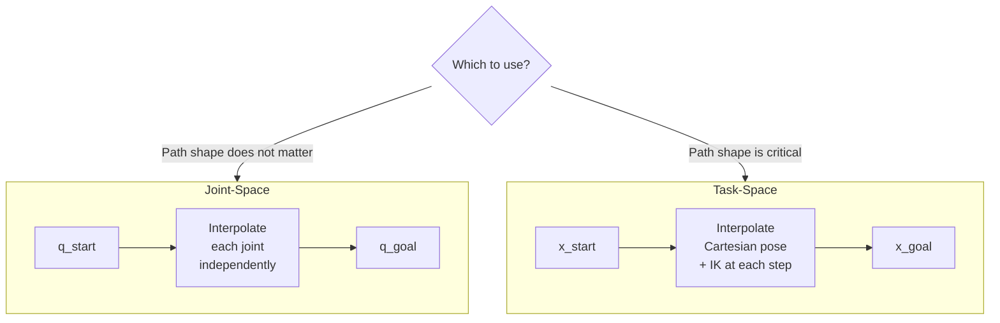
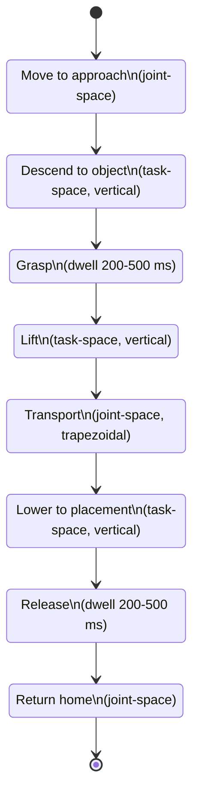

import RoboticsComments from '../../../../components/robotics/RoboticsComments.astro';
import TawkWidget from '../../../../components/TawkWidget.astro';
import UniversalContentContributors from '../../../../components/UniversalContentContributors.astro';
import InArticleAd from '../../../../components/InArticleAd.astro';
import Copyright from '../../../../components/Copyright.astro';
import BionicText from '../../../../components/BionicText.astro';
import TailwindWrapper from '../../../../components/TailwindWrapper.jsx';
import { Tabs, TabItem } from '@astrojs/starlight/components';
import { Card, CardGrid, Badge, Steps, LinkButton, FileTree } from '@astrojs/starlight/components';

<UniversalContentContributors 
  contributors={frontmatter.contributors}
/>


A robot arm that is told only where to go tries to be there at once. Its motors cannot do that, so the arm shakes, a box slips from the gripper, or a cup of liquid spills. A path says where the arm goes. A trajectory says where and when: it gives the position at every moment, and so it fixes the speed and the acceleration too. This lesson shows how to choose that timing for a warehouse arm that moves boxes from a shelf to a conveyor, so that every motion is one the motors can make. #TrajectoryPlanning #MotionControl #Robotics

## Learning Objectives

By the end of this lesson, you will be able to:

1. Compare joint-space and task-space trajectory planning approaches and select the appropriate one for a given task
2. Derive cubic and quintic polynomial trajectories with specified boundary conditions
3. Implement trapezoidal velocity profiles that respect actuator velocity and acceleration limits
4. Construct spline trajectories through multiple via points with continuous velocity and acceleration
5. Sequence a complete pick-and-place operation with approach, grasp, transport, place, and return phases

## Real-World Engineering Challenge: Warehouse Mobile Manipulator Pick-and-Place

<InArticleAd />


A warehouse robot must pick boxes from storage shelves and place them on a conveyor belt. Its arm has six joints (six degrees of freedom, 6-DOF) and stands on a mobile base. Motion that jerks makes the gripper drop boxes, damages products and wears the motors and gears early. The arm must reach boxes at different shelf heights, keep clear of the shelf edges, and finish one pick and one place in under 8 seconds. That time is the cycle time.

:::note[Key Engineering Questions]
1. How do we make a joint start and stop with no sudden jump in velocity?
2. Should the motion be planned in the joint angles or in the position of the gripper, and when is each one right?
3. How do we keep inside the largest velocity and the largest acceleration the motors can give?
4. How do we join the steps of the full cycle (approach, descend, grasp, lift, transport, lower, release, return) smoothly?
:::

### Why Trajectory Smoothness Matters

Three quantities describe the motion of a joint. Velocity is how fast the angle changes, in degrees per second (deg/s). Acceleration is how fast the velocity changes, in deg/s². Jerk is how fast the acceleration changes.

A motor cannot change its velocity in no time. That would need an acceleration without limit, and so a torque without limit. A trajectory that asks for it gets vibration, an arm that falls behind the plan, and stress in the gears.

A standing passenger in a bus feels the same thing: a steady speed, however high, is easy, but a sharp start or stop (a sudden change of acceleration) throws them. A box in a gripper is that passenger. So a good trajectory has a velocity with no jumps, and for a fragile load an acceleration with no jumps.

## Fundamental Theory

<InArticleAd />


### Joint-Space vs. Task-Space Trajectory Planning



A motion can be planned in two places. Joint space is the set of joint angles of the arm. Task space (also called Cartesian space) is the position and orientation of the gripper, in meters along x, y and z. Planning means interpolating: finding the values between a start and a goal.

<Tabs>
<TabItem label="Joint-Space Planning">

**How it works:** Take the joint angles at the start, $\mathbf{q}_0$, and at the goal, $\mathbf{q}_f$. Move each joint from its start to its goal as a function of time $t$, without regard to the other joints.

**Advantages:**
- Simple: each joint follows its own curve
- No trouble from singularities, the poses where the arm loses a direction of motion
- Stays inside the joint limits if the start and the goal are inside them
- Needs little calculation

**Disadvantages:**
- The gripper moves along a curve that is hard to predict
- The tool tip cannot be made to move in a straight line
- Not suitable when the path of the gripper matters (welding a seam, passing an obstacle)

**Best for:** moves where only the start and the end matter, such as the long move from the shelf to the conveyor.

</TabItem>
<TabItem label="Task-Space Planning">

**How it works:** Take the pose of the gripper at the start, $\mathbf{x}_0$, and at the goal, $\mathbf{x}_f$. Interpolate the position (and the orientation, with the quaternion SLERP of [Orientation and Quaternions](/education/robotics/orientation-quaternions/)). At each time step, solve the inverse kinematics (IK): the joint angles that put the gripper at that pose.

**Advantages:**
- Full control of the path of the gripper (a straight line, an arc, any shape)
- Needed where the path is the task (painting, welding, deburring)
- Obstacles are easier to describe

**Disadvantages:**
- IK must be solved at every time step, which costs calculation
- The path may pass through a singularity, and near one the joint velocities become very large
- Nothing guarantees that the joints stay inside their limits along the path

**Best for:** motions where the path matters, such as a vertical descent onto a box.

</TabItem>
</Tabs>

:::note[Practical Approach]
Most industrial pick-and-place systems use both: joint space for the large moves, task space for the short moves near the box.
:::

### Linear Interpolation: The Simplest Trajectory

The simplest trajectory moves the joint at one constant velocity from start to goal. Call the joint position $q$ (in degrees or radians), its start value $q_0$, its goal value $q_f$, the time $t$ and the duration of the move $t_f$ (both in seconds):

$$
q(t) = q_0 + \frac{q_f - q_0}{t_f} \cdot t, \quad 0 \leq t \leq t_f
$$

The velocity $\dot{q}$ (the dot means "rate of change with time") is the distance divided by the duration:

$$
\dot{q}(t) = \frac{q_f - q_0}{t_f}
$$

A move of $90°$ in 2 s has $\dot{q} = 90 / 2 = 45$ deg/s for the whole move, so the velocity must jump from zero to 45 deg/s at $t=0$ and back to zero at $t=t_f$, and a jump in velocity needs an acceleration without limit. Linear interpolation is therefore used only as a part of better methods, such as the cruise part of the trapezoidal profile below.

### Cubic Polynomial Interpolation

To start and stop at rest, the trajectory must meet four conditions: the position and the velocity at the start, and the position and the velocity at the end. A cubic polynomial has four coefficients, $a_0$ to $a_3$, so it is the simplest curve that can meet all four:

$$
q(t) = a_0 + a_1 t + a_2 t^2 + a_3 t^3
$$

Its velocity $\dot{q}$ and its acceleration $\ddot{q}$ (two dots: the rate of change of the velocity) follow by differentiating:

$$
\dot{q}(t) = a_1 + 2a_2 t + 3a_3 t^2
$$

$$
\ddot{q}(t) = 2a_2 + 6a_3 t
$$

#### Boundary Conditions

The four conditions are called boundary conditions. For a motion from rest at $q_0$ to rest at $q_f$ in a time $t_f$:

$$
q(0) = q_0, \quad q(t_f) = q_f, \quad \dot{q}(0) = 0, \quad \dot{q}(t_f) = 0
$$

#### Coefficient Derivation

Each condition gives one equation. At $t = 0$ every term with $t$ vanishes, so $q(0) = q_0$ gives:

$$a_0 = q_0$$

and $\dot{q}(0) = 0$ gives:

$$a_1 = 0$$

The two conditions at $t_f$ are two equations in $a_2$ and $a_3$. Their solution (worked out in the box below) is:

$$
a_2 = \frac{3(q_f - q_0)}{t_f^2}
$$

$$
a_3 = \frac{-2(q_f - q_0)}{t_f^3}
$$

**With numbers.** A joint moves from $0°$ to $90°$ in 2 s:

$$
a_2 = \frac{3 \times 90}{2^2} = 67.5 \text{ deg/s}^2, \qquad a_3 = \frac{-2 \times 90}{2^3} = -22.5 \text{ deg/s}^3
$$

The velocity is highest at the middle of the move, $t = 1$ s: $\dot{q} = 2(67.5)(1) + 3(-22.5)(1)^2 = 67.5$ deg/s. That is 1.5 times the 45 deg/s of the constant-velocity move, because the joint must make up for its slow start and slow end. The acceleration at the start is $\ddot{q}(0) = 2 a_2 = 135$ deg/s². It does not begin at zero: it jumps to 135 deg/s² at the first instant.

<details>
<summary>Full derivation of the coefficient system</summary>

Starting from the four equations:

$$
a_0 = q_0
$$

$$
a_1 = 0
$$

$$
a_0 + a_1 t_f + a_2 t_f^2 + a_3 t_f^3 = q_f
$$

$$
a_1 + 2 a_2 t_f + 3 a_3 t_f^2 = 0
$$

Substituting $a_0 = q_0$ and $a_1 = 0$ into the last two equations:

$$
q_0 + a_2 t_f^2 + a_3 t_f^3 = q_f
$$

$$
2 a_2 t_f + 3 a_3 t_f^2 = 0
$$

From the velocity equation: $a_2 = -\frac{3}{2} a_3 t_f$

Substituting into the position equation:

$$
q_0 - \frac{3}{2} a_3 t_f^3 + a_3 t_f^3 = q_f
$$

$$
-\frac{1}{2} a_3 t_f^3 = q_f - q_0
$$

$$
a_3 = \frac{-2(q_f - q_0)}{t_f^3}
$$

And therefore:

$$
a_2 = -\frac{3}{2} \cdot \frac{-2(q_f - q_0)}{t_f^3} \cdot t_f = \frac{3(q_f - q_0)}{t_f^2}
$$

</details>

### Quintic Polynomial: Acceleration Continuity

The cubic leaves a jump in acceleration at each end, and a fragile load feels it. A quintic (5th-degree) polynomial has six coefficients, so it can meet six conditions: position, velocity and acceleration at both ends. With the acceleration set to zero at both ends, the push on the load grows from nothing and returns to nothing.

$$
q(t) = a_0 + a_1 t + a_2 t^2 + a_3 t^3 + a_4 t^4 + a_5 t^5
$$

For a motion from rest to rest with zero acceleration at both ends ($q(0) = q_0$, $q(t_f) = q_f$, $\dot{q}(0) = \dot{q}(t_f) = 0$, $\ddot{q}(0) = \ddot{q}(t_f) = 0$), the coefficients are:

$$
a_0 = q_0, \quad a_1 = 0, \quad a_2 = 0
$$

$$
a_3 = \frac{10(q_f - q_0)}{t_f^3}, \quad a_4 = \frac{-15(q_f - q_0)}{t_f^4}, \quad a_5 = \frac{6(q_f - q_0)}{t_f^5}
$$

:::note[When to use quintic over cubic]
Use a cubic when a jump in acceleration at the two ends does no harm. Use a quintic when the robot carries a fragile load, or when several segments are joined and the acceleration must not jump where they meet.
:::

### Trapezoidal Velocity Profile

A polynomial is given a duration, and its peak velocity and acceleration follow from it. A motor works the other way round: given its largest velocity $v_{max}$ and largest acceleration $a_{max}$, how fast can the move be? Use each limit fully, as a lift does between floors: speed up at $a_{max}$, cruise at $v_{max}$, slow down at $a_{max}$. The velocity against time is then a trapezoid, and no other motion inside the two limits is faster.

```text
  velocity
    ^
    |
 v_max      +-------------------+
    |      /                     \
    |     /                       \
    |    /                         \
    |   /                           \
    +--+----+-------------------+----+--> time
       0   t_a               t_a+t_c t_f

       speed up    cruise     slow down
       (+a_max)  (v = v_max)  (-a_max)
```

For a move of size $\Delta q = q_f - q_0 > 0$, the three phases are:

**Phase 1: Acceleration** ($0 \leq t \leq t_a$)

$$
q(t) = q_0 + \frac{1}{2} a_{max} t^2, \quad \dot{q}(t) = a_{max} \cdot t
$$

**Phase 2: Cruise** ($t_a \leq t \leq t_a + t_c$)

$$
q(t) = q_0 + v_{max}\left(t - \frac{t_a}{2}\right), \quad \dot{q}(t) = v_{max}
$$

**Phase 3: Deceleration** ($t_a + t_c \leq t \leq t_f$)

$$
\dot{q}(t) = v_{max} - a_{max}(t - t_a - t_c)
$$

The times follow from the limits. The time to speed up, $t_a$, is the velocity to reach divided by the acceleration. The cruise time $t_c$ covers the distance that the two ramps do not. The total time is $t_f$:

$$
t_a = \frac{v_{max}}{a_{max}}, \quad t_c = \frac{\Delta q}{v_{max}} - \frac{v_{max}}{a_{max}}, \quad t_f = 2t_a + t_c
$$

**With numbers.** A joint must move $90°$. Its motor allows $v_{max} = 60$ deg/s and $a_{max} = 120$ deg/s²:

$$
t_a = \frac{60}{120} = 0.5 \text{ s}, \qquad t_c = \frac{90}{60} - \frac{60}{120} = 1.5 - 0.5 = 1.0 \text{ s}, \qquad t_f = 2(0.5) + 1.0 = 2.0 \text{ s}
$$

No trajectory can make this move in less than 2.0 s with this motor. The cubic for the same move in 2.0 s needed 67.5 deg/s and 135 deg/s², which are both above the limits.

:::caution[Triangular Profile Case]
A short move ends before the joint reaches $v_{max}$. There is no cruise ($t_c = 0$) and the profile is a triangle. This occurs when $\Delta q < \frac{v_{max}^2}{a_{max}}$, which is $60^2 / 120 = 30°$ for the motor above. The peak velocity is then $v_{peak} = \sqrt{a_{max} \cdot \Delta q}$ and the total time is $t_f = 2\sqrt{\frac{\Delta q}{a_{max}}}$.
:::

<Card title="S-Curve Profiles: Adding a Jerk Limit" icon="information">
In a trapezoidal profile the acceleration jumps at four places: at the start and the end of each ramp. Each jump is a jerk ($\dddot{q}$) without limit. For a fragile load (electronics, a surgical tool, a full cup of liquid) the jump is felt as a knock.

The **S-curve** (or seven-segment) profile removes the jumps. It has a third limit, $j_{\max}$, on the jerk. The acceleration rises to $a_{\max}$ along a ramp, holds, and returns to zero along a ramp, so each end of the velocity curve is rounded into an S shape. Most industrial motion controllers (Siemens SIMATIC, Rockwell Kinetix, Beckhoff TwinCAT) include S-curve generators.
</Card>

<Card title="Beyond Trapezoidal: TOPP for Time-Optimal Paths" icon="rocket">
The trapezoidal profile is the fastest motion **for one joint at a time**. When a whole arm follows a path in task space, a different joint reaches its limit at each point of the path. Finding the fastest timing along a fixed path under all the limits together is called **Time-Optimal Path Parameterization** (TOPP).

A widely used method is **TOPP-RA** (Pham & Pham, 2017). It is available in [toppra (Python)](https://hungpham2511.github.io/toppra/), [Drake](https://drake.mit.edu/), and as the `contopp` option in MATLAB's Robotics System Toolbox.
</Card>

### Spline Interpolation Through Multiple Waypoints

Often the arm must pass through several points on the way, called waypoints or via points (for example, a row of shelf locations). A separate rest-to-rest cubic between each pair of points would make the arm stop at every point. A cubic spline joins the cubics so that the arm passes through each point without stopping.

For $n+1$ waypoints $q_0, q_1, \ldots, q_n$ at times $t_0, t_1, \ldots, t_n$, there are $n$ cubic segments. At each waypoint $k$ between the first and the last, the segment that arrives and the segment that leaves must agree in three things:

1. **Position:** both segments pass through $q_k$.
2. **Velocity:** $\dot{q}_{k}^{-} = \dot{q}_{k}^{+}$ (the velocity just before the waypoint equals the velocity just after it).
3. **Acceleration:** $\ddot{q}_{k}^{-} = \ddot{q}_{k}^{+}$.

Add rest at the two ends, $\dot{q}(t_0) = 0$ and $\dot{q}(t_n) = 0$, and there are as many equations as unknown coefficients. Each waypoint is linked only to its two neighbors (a tridiagonal system), so a computer solves the equations quickly.

<details>
<summary>Via-point velocity estimation</summary>

When the times of the via points are given but their velocities are not, a common rule is to give each inner via point the average of the two straight-line velocities on either side of it:

$$
\dot{q}_k = \frac{1}{2}\left(\frac{q_k - q_{k-1}}{t_k - t_{k-1}} + \frac{q_{k+1} - q_k}{t_{k+1} - t_k}\right)
$$

If the two adjacent segments have opposite signs (the joint reverses direction), the via-point velocity is set to zero.

</details>

### Pick-and-Place Task Phases



A pick-and-place operation is a chain of segments, each with its own kind of trajectory. Each segment starts at the position where the one before it ended. The home configuration is the pose where the arm waits between cycles.

<Steps>
1. **Move to approach position**
   A joint-space cubic from the home configuration to a position above the box. This is a large move through free space, and the path of the gripper does not matter.

2. **Descend to object**
   A straight vertical line in task space, from the approach position down to the grasp position, with IK at each step. The gripper meets the box from directly above.

3. **Grasp**
   The arm holds still while the gripper closes. This pause is called a dwell, typically 200 to 500 ms.

4. **Lift**
   A straight vertical line in task space, up to a safe height above the shelf, so that the box does not catch the shelf edge.

5. **Transport**
   A joint-space move from above the shelf to above the conveyor. It is the longest segment, so it uses a trapezoidal velocity profile, the fastest the motors allow.

6. **Lower to placement**
   A straight vertical line in task space, down to the place position on the conveyor.

7. **Release**
   The gripper opens. Dwell: 200 to 500 ms.

8. **Return home**
   A joint-space move to the home configuration, ready for the next cycle.
</Steps>

### Via Points and Blending

A full stop at every via point wastes time. Blending rounds the corner: the arm passes near the via point, not exactly through it, and does not stop. The robot gives up a little accuracy of the path and gains cycle time.

A common method sets a blend radius $r$ around each via point. Inside that distance, a curve (a parabola or an arc) replaces the corner. Outside it, the arm follows the straight segments at cruise velocity. A larger radius gives a smoother and faster corner that passes farther from the via point.

### Cartesian Straight-Line Motion

For the task-space segments (descent, lift, placement) the gripper must follow a straight line, but the motors turn joints. The link between the two is the Jacobian $J$, a matrix that converts joint velocities to the velocity of the gripper (see [Velocity Kinematics and the Jacobian](/education/robotics/velocity-kinematics-jacobian/)). Used in reverse, it gives the joint velocities $\dot{\mathbf{q}}$ needed for a wanted gripper velocity $\dot{\mathbf{x}}$:

$$
\dot{\mathbf{q}} = J(\mathbf{q})^{-1} \dot{\mathbf{x}}
$$

An arm with more joints than the task needs (a redundant arm) has no ordinary inverse, and uses the pseudoinverse $J^{\dagger}$ in its place:

$$
\dot{\mathbf{q}} = J^{\dagger}(\mathbf{q}) \dot{\mathbf{x}}
$$

The straight line is cut into small steps, and at each step the joint values come from IK or from the formula above.

<Card title="What If the Cartesian Path Is Infeasible?" icon="warning">
A straight line for the gripper can ask for joint velocities above the motor limits. This occurs near the edge of the workspace and near a singularity, where a small motion of the gripper needs a large motion of the joints. So check a task-space trajectory before it runs. Step along the path at the planned speed, calculate $\dot{\mathbf{q}} = J^{\dagger} \dot{\mathbf{x}}$ at each step, and confirm that every joint velocity stays within `[-v_max, v_max]` and every joint acceleration within `[-a_max, a_max]`.

If a step breaks a limit, there are three remedies:
1. **Slow the whole trajectory**: reduce the cruise velocity of the gripper until the worst joint is inside its limits. Easy to do, and it costs time.
2. **Retime with TOPP**: find the fastest speed profile along the same path. Best if the shape of the path must stay.
3. **Replan the path**: move the via points away from the singularity and accept a curve in place of the straight line. Best when the shape may change.

If the controller is given velocities the motors cannot reach, the robot falls behind the plan, or the safety limits of the controller stop the motion in the middle of the task.
</Card>

### Python Implementation: Cubic Polynomial Trajectory

```python
import numpy as np
import matplotlib.pyplot as plt

def cubic_trajectory(q0, qf, tf, dt=0.01):
    """Generate a cubic polynomial rest-to-rest trajectory.

    Parameters
    ----------
    q0 : float
        Start position (rad or m).
    qf : float
        End position (rad or m).
    tf : float
        Duration (s).
    dt : float
        Time step (s).

    Returns
    -------
    t : ndarray
        Time vector.
    q : ndarray
        Position profile.
    qd : ndarray
        Velocity profile.
    qdd : ndarray
        Acceleration profile.
    """
    # Compute coefficients
    a0 = q0
    a1 = 0.0
    a2 = 3.0 * (qf - q0) / tf**2
    a3 = -2.0 * (qf - q0) / tf**3

    t = np.arange(0, tf + dt, dt)
    q = a0 + a1 * t + a2 * t**2 + a3 * t**3
    qd = a1 + 2 * a2 * t + 3 * a3 * t**2
    qdd = 2 * a2 + 6 * a3 * t

    return t, q, qd, qdd

def quintic_trajectory(q0, qf, tf, dt=0.01):
    """Generate a quintic polynomial rest-to-rest trajectory.

    Parameters
    ----------
    q0, qf : float
        Start and end positions.
    tf : float
        Duration (s).
    dt : float
        Time step (s).

    Returns
    -------
    t, q, qd, qdd : ndarray
        Time, position, velocity, acceleration.
    """
    a0 = q0
    a1 = 0.0
    a2 = 0.0
    a3 = 10.0 * (qf - q0) / tf**3
    a4 = -15.0 * (qf - q0) / tf**4
    a5 = 6.0 * (qf - q0) / tf**5

    t = np.arange(0, tf + dt, dt)
    q = a0 + a1*t + a2*t**2 + a3*t**3 + a4*t**4 + a5*t**5
    qd = a1 + 2*a2*t + 3*a3*t**2 + 4*a4*t**3 + 5*a5*t**4
    qdd = 2*a2 + 6*a3*t + 12*a4*t**2 + 20*a5*t**3

    return t, q, qd, qdd

# === Example: Joint 1 moves from 0 to 90 degrees in 2 seconds ===
q0 = 0.0
qf = np.radians(90)
tf = 2.0

t_c, q_c, qd_c, qdd_c = cubic_trajectory(q0, qf, tf)
t_q, q_q, qd_q, qdd_q = quintic_trajectory(q0, qf, tf)

fig, axes = plt.subplots(3, 1, figsize=(10, 8), sharex=True)

# Position
axes[0].plot(t_c, np.degrees(q_c), 'b-', label='Cubic', linewidth=2)
axes[0].plot(t_q, np.degrees(q_q), 'r--', label='Quintic', linewidth=2)
axes[0].set_ylabel('Position (deg)')
axes[0].legend()
axes[0].set_title('Cubic vs Quintic Polynomial Trajectory')
axes[0].grid(True, alpha=0.3)

# Velocity
axes[1].plot(t_c, np.degrees(qd_c), 'b-', label='Cubic', linewidth=2)
axes[1].plot(t_q, np.degrees(qd_q), 'r--', label='Quintic', linewidth=2)
axes[1].set_ylabel('Velocity (deg/s)')
axes[1].legend()
axes[1].grid(True, alpha=0.3)

# Acceleration
axes[2].plot(t_c, np.degrees(qdd_c), 'b-', label='Cubic', linewidth=2)
axes[2].plot(t_q, np.degrees(qdd_q), 'r--', label='Quintic', linewidth=2)
axes[2].set_ylabel('Acceleration (deg/s²)')
axes[2].set_xlabel('Time (s)')
axes[2].legend()
axes[2].grid(True, alpha=0.3)

plt.tight_layout()
plt.savefig('cubic_vs_quintic_trajectory.png', dpi=150)
plt.show()

print(f"Cubic  - peak velocity: {np.degrees(max(qd_c)):.1f} deg/s")
print(f"Quintic - peak velocity: {np.degrees(max(qd_q)):.1f} deg/s")
print(f"Cubic  - peak accel: {np.degrees(max(abs(qdd_c))):.1f} deg/s²")
print(f"Quintic - peak accel: {np.degrees(max(abs(qdd_q))):.1f} deg/s²")
```

:::note[Key Observation]
The acceleration of the cubic jumps at the start and at the end. The quintic starts and ends with zero acceleration. The price is a higher peak velocity for the same duration: $1.875\,\Delta q / t_f$ against $1.5\,\Delta q / t_f$ for the cubic, 25% more. The peak acceleration is about the same ($5.77\,\Delta q / t_f^2$ against $6\,\Delta q / t_f^2$). For the $90°$ move in 2 s, the program prints 67.5 deg/s and 135.0 deg/s² for the cubic, and 84.4 deg/s and 129.9 deg/s² for the quintic.
:::

### Python Implementation: Trapezoidal Velocity Profile

```python
import numpy as np
import matplotlib.pyplot as plt

def trapezoidal_profile(q0, qf, v_max, a_max, dt=0.001):
    """Generate a trapezoidal velocity profile trajectory.

    Parameters
    ----------
    q0, qf : float
        Start and end positions.
    v_max : float
        Maximum velocity.
    a_max : float
        Maximum acceleration (and deceleration).
    dt : float
        Time step (s).

    Returns
    -------
    t, q, qd, qdd : ndarray
        Time, position, velocity, acceleration arrays.
    """
    dq = qf - q0
    sign = np.sign(dq)
    dq = abs(dq)

    # Check if we can reach v_max
    if dq < v_max**2 / a_max:
        # Triangular profile: cannot reach v_max
        v_peak = np.sqrt(a_max * dq)
        t_a = v_peak / a_max
        t_c = 0.0
        t_d = t_a
    else:
        # Trapezoidal profile
        t_a = v_max / a_max
        t_c = dq / v_max - v_max / a_max
        t_d = t_a
        v_peak = v_max

    t_f = t_a + t_c + t_d
    t = np.arange(0, t_f + dt, dt)

    q = np.zeros_like(t)
    qd = np.zeros_like(t)
    qdd = np.zeros_like(t)

    for i, ti in enumerate(t):
        if ti <= t_a:
            # Acceleration phase
            qdd[i] = a_max
            qd[i] = a_max * ti
            q[i] = 0.5 * a_max * ti**2
        elif ti <= t_a + t_c:
            # Cruise phase
            dt_cruise = ti - t_a
            qdd[i] = 0.0
            qd[i] = v_peak
            q[i] = 0.5 * a_max * t_a**2 + v_peak * dt_cruise
        else:
            # Deceleration phase
            dt_decel = ti - t_a - t_c
            qdd[i] = -a_max
            qd[i] = v_peak - a_max * dt_decel
            q[i] = (0.5 * a_max * t_a**2
                     + v_peak * t_c
                     + v_peak * dt_decel
                     - 0.5 * a_max * dt_decel**2)

    # Apply direction and offset
    q = q0 + sign * q
    qd = sign * qd
    qdd = sign * qdd

    return t, q, qd, qdd

# === Example: Joint moves 90 degrees with actuator limits ===
q0 = 0.0
qf = np.radians(90)
v_max = np.radians(60)   # 60 deg/s max velocity
a_max = np.radians(120)  # 120 deg/s² max acceleration

t, q, qd, qdd = trapezoidal_profile(q0, qf, v_max, a_max)

fig, axes = plt.subplots(3, 1, figsize=(10, 8), sharex=True)

axes[0].plot(t, np.degrees(q), 'b-', linewidth=2)
axes[0].set_ylabel('Position (deg)')
axes[0].set_title('Trapezoidal Velocity Profile Trajectory')
axes[0].grid(True, alpha=0.3)

axes[1].plot(t, np.degrees(qd), 'g-', linewidth=2)
axes[1].axhline(y=np.degrees(v_max), color='r', linestyle='--', alpha=0.5, label='v_max')
axes[1].set_ylabel('Velocity (deg/s)')
axes[1].legend()
axes[1].grid(True, alpha=0.3)

axes[2].plot(t, np.degrees(qdd), 'm-', linewidth=2)
axes[2].axhline(y=np.degrees(a_max), color='r', linestyle='--', alpha=0.5, label='a_max')
axes[2].axhline(y=-np.degrees(a_max), color='r', linestyle='--', alpha=0.5)
axes[2].set_ylabel('Acceleration (deg/s²)')
axes[2].set_xlabel('Time (s)')
axes[2].legend()
axes[2].grid(True, alpha=0.3)

plt.tight_layout()
plt.savefig('trapezoidal_profile.png', dpi=150)
plt.show()

t_a_val = np.degrees(v_max) / np.degrees(a_max)
print(f"Acceleration time: {t_a_val:.3f} s")
print(f"Total time: {t[-1]:.3f} s")
print(f"Peak velocity: {np.degrees(max(qd)):.1f} deg/s")
```

### Python Implementation: Complete Pick-and-Place Trajectory

```python
import numpy as np
import matplotlib.pyplot as plt

def cubic_trajectory(q0, qf, tf, dt=0.01):
    """Cubic polynomial rest-to-rest trajectory."""
    a0 = q0
    a2 = 3.0 * (qf - q0) / tf**2
    a3 = -2.0 * (qf - q0) / tf**3
    t = np.arange(0, tf + dt, dt)
    q = a0 + a2 * t**2 + a3 * t**3
    qd = 2 * a2 * t + 3 * a3 * t**2
    return t, q, qd

def plan_pick_and_place():
    """Plan a complete pick-and-place trajectory for a 3-joint planar arm.

    Phases:
    1. Home -> Approach (joint-space cubic)
    2. Approach -> Grasp position (task-space vertical descent, simulated as joint-space)
    3. Dwell for grasping
    4. Grasp position -> Lift (vertical ascent)
    5. Lift -> Above conveyor (joint-space cubic, transport)
    6. Above conveyor -> Place position (vertical descent)
    7. Dwell for release
    8. Place position -> Home (joint-space cubic)
    """

    # Joint configurations (radians) for a 3-joint planar arm
    # [shoulder, elbow, wrist]
    q_home     = np.array([0.0, 0.0, 0.0])
    q_approach = np.array([0.5, -0.8, 0.3])     # above the box on shelf
    q_grasp    = np.array([0.6, -1.0, 0.4])     # at the box (descended)
    q_lift     = np.array([0.5, -0.8, 0.3])     # lifted above shelf
    q_above_cv = np.array([-0.4, -0.6, 0.2])    # above conveyor
    q_place    = np.array([-0.35, -0.75, 0.25]) # at conveyor (descended)

    # Phase durations (seconds)
    t_move_to_approach = 1.5
    t_descend = 0.6
    t_grasp_dwell = 0.3
    t_lift = 0.6
    t_transport = 2.0
    t_lower = 0.6
    t_release_dwell = 0.3
    t_return = 1.5

    all_t = []
    all_q = [[], [], []]  # one list per joint
    all_labels = []
    t_offset = 0.0

    phases = [
        ("Move to approach", q_home, q_approach, t_move_to_approach),
        ("Descend", q_approach, q_grasp, t_descend),
        ("Grasp (dwell)", q_grasp, q_grasp, t_grasp_dwell),
        ("Lift", q_grasp, q_lift, t_lift),
        ("Transport", q_lift, q_above_cv, t_transport),
        ("Lower", q_above_cv, q_place, t_lower),
        ("Release (dwell)", q_place, q_place, t_release_dwell),
        ("Return home", q_place, q_home, t_return),
    ]

    for name, q_start, q_end, duration in phases:
        for j in range(3):
            t_seg, q_seg, _ = cubic_trajectory(q_start[j], q_end[j], duration)
            if len(all_t) > 0 and j == 0:
                # Offset time for this phase
                pass
            all_q[j].extend(q_seg + 0 if len(all_q[j]) == 0 else q_seg.tolist())

        t_seg, _, _ = cubic_trajectory(0, 0, duration)
        all_t.extend((t_seg + t_offset).tolist())
        all_labels.append((t_offset, t_offset + duration, name))
        t_offset += duration

    # Rebuild cleanly
    # (The loop above was a first attempt. The lists are emptied and filled again here.)
    all_t = []
    all_q = [[], [], []]
    t_offset = 0.0

    for name, q_start, q_end, duration in phases:
        t_seg = np.arange(0, duration + 0.01, 0.01)
        for j in range(3):
            _, q_seg, _ = cubic_trajectory(q_start[j], q_end[j], duration)
            all_q[j].extend(q_seg.tolist())
        all_t.extend((t_seg + t_offset).tolist())
        t_offset += duration

    all_t = np.array(all_t)
    all_q = [np.array(q) for q in all_q]

    # Plot
    fig, axes = plt.subplots(3, 1, figsize=(14, 10), sharex=True)
    joint_names = ['Shoulder', 'Elbow', 'Wrist']
    colors = ['#2196F3', '#FF5722', '#4CAF50']

    for j in range(3):
        axes[j].plot(all_t, np.degrees(all_q[j]), color=colors[j], linewidth=2)
        axes[j].set_ylabel(f'{joint_names[j]} (deg)')
        axes[j].grid(True, alpha=0.3)

    # Add phase annotations
    phase_colors = ['#E3F2FD', '#FFF3E0', '#FFEBEE', '#E8F5E9',
                    '#F3E5F5', '#FFF3E0', '#FFEBEE', '#E3F2FD']
    t_start = 0.0
    for i, (name, _, _, duration) in enumerate(phases):
        for j in range(3):
            axes[j].axvspan(t_start, t_start + duration,
                          alpha=0.15, color=phase_colors[i % len(phase_colors)])
        axes[2].text(t_start + duration / 2, axes[2].get_ylim()[0] + 2,
                    name, ha='center', va='bottom', fontsize=7, rotation=45)
        t_start += duration

    axes[0].set_title('Complete Pick-and-Place Joint Trajectories')
    axes[2].set_xlabel('Time (s)')

    plt.tight_layout()
    plt.savefig('pick_and_place_trajectory.png', dpi=150)
    plt.show()

    total_time = sum(d for _, _, _, d in phases)
    print(f"Total cycle time: {total_time:.1f} s")
    print(f"\nPhase breakdown:")
    for name, _, _, duration in phases:
        print(f"  {name}: {duration:.1f} s")

plan_pick_and_place()
```

### Python Implementation: Interpolation Method Comparison

```python
import numpy as np
import matplotlib.pyplot as plt

def linear_interp(q0, qf, tf, dt=0.01):
    """Linear interpolation (discontinuous velocity)."""
    t = np.arange(0, tf + dt, dt)
    q = q0 + (qf - q0) * t / tf
    qd = np.full_like(t, (qf - q0) / tf)
    qdd = np.zeros_like(t)
    # Mark discontinuities at endpoints
    qdd[0] = float('inf')
    qdd[-1] = float('inf')
    return t, q, qd, qdd

def cubic_interp(q0, qf, tf, dt=0.01):
    """Cubic polynomial (continuous velocity, discontinuous acceleration)."""
    a2 = 3.0 * (qf - q0) / tf**2
    a3 = -2.0 * (qf - q0) / tf**3
    t = np.arange(0, tf + dt, dt)
    q = q0 + a2 * t**2 + a3 * t**3
    qd = 2 * a2 * t + 3 * a3 * t**2
    qdd = 2 * a2 + 6 * a3 * t
    return t, q, qd, qdd

def quintic_interp(q0, qf, tf, dt=0.01):
    """Quintic polynomial (continuous acceleration)."""
    a3 = 10.0 * (qf - q0) / tf**3
    a4 = -15.0 * (qf - q0) / tf**4
    a5 = 6.0 * (qf - q0) / tf**5
    t = np.arange(0, tf + dt, dt)
    q = q0 + a3 * t**3 + a4 * t**4 + a5 * t**5
    qd = 3 * a3 * t**2 + 4 * a4 * t**3 + 5 * a5 * t**4
    qdd = 6 * a3 * t + 12 * a4 * t**2 + 20 * a5 * t**3
    return t, q, qd, qdd

# Parameters
q0 = 0.0
qf = np.radians(90)
tf = 2.0

methods = {
    'Linear': linear_interp(q0, qf, tf),
    'Cubic': cubic_interp(q0, qf, tf),
    'Quintic': quintic_interp(q0, qf, tf),
}

fig, axes = plt.subplots(3, 1, figsize=(12, 9), sharex=True)
styles = {'Linear': ('gray', '-'), 'Cubic': ('blue', '-'), 'Quintic': ('red', '--')}

for name, (t, q, qd, qdd) in methods.items():
    color, ls = styles[name]
    axes[0].plot(t, np.degrees(q), color=color, linestyle=ls, linewidth=2, label=name)
    axes[1].plot(t, np.degrees(qd), color=color, linestyle=ls, linewidth=2, label=name)
    if name != 'Linear':
        axes[2].plot(t, np.degrees(qdd), color=color, linestyle=ls, linewidth=2, label=name)

axes[0].set_ylabel('Position (deg)')
axes[0].set_title('Comparison of Trajectory Interpolation Methods')
axes[0].legend()
axes[0].grid(True, alpha=0.3)

axes[1].set_ylabel('Velocity (deg/s)')
axes[1].legend()
axes[1].grid(True, alpha=0.3)

axes[2].set_ylabel('Acceleration (deg/s²)')
axes[2].set_xlabel('Time (s)')
axes[2].legend()
axes[2].grid(True, alpha=0.3)
axes[2].set_title('Acceleration (Linear omitted: infinite at endpoints)')

plt.tight_layout()
plt.savefig('interpolation_comparison.png', dpi=150)
plt.show()

# Print summary table
print(f"{'Method':<10} {'Peak Vel (deg/s)':<20} {'Peak Accel (deg/s²)':<22} {'Accel at t=0':<18}")
print("-" * 70)
for name, (t, q, qd, qdd) in methods.items():
    pv = np.degrees(np.max(np.abs(qd)))
    if name == 'Linear':
        pa = "inf (discontinuous)"
        a0_str = "inf"
    else:
        pa = f"{np.degrees(np.max(np.abs(qdd))):.1f}"
        a0_str = f"{np.degrees(qdd[0]):.1f}"
    print(f"{name:<10} {pv:<20.1f} {pa:<22} {a0_str:<18}")
```

## System Application: Full Pick-and-Place Sequence

<InArticleAd />


The warehouse robot must pick a box from a shelf at a height of 1.2 m and place it on a conveyor at 0.8 m. Each joint motor allows at most 120 deg/s and 300 deg/s². The cycle must take less than 8 seconds.

**Trajectory for each phase:**

| Phase | Planning Space | Method | Reason |
|-------|---------------|--------|-----------|
| Move to approach | Joint space | Trapezoidal | Large move, fastest profile |
| Descend to object | Task space | Cubic polynomial | Short, straight and smooth |
| Grasp (dwell) | None | Hold position | Gripper closes |
| Lift | Task space | Cubic polynomial | Straight and smooth |
| Transport | Joint space | Trapezoidal | Longest move, fastest profile |
| Lower to placement | Task space | Cubic polynomial | Straight and smooth |
| Release (dwell) | None | Hold position | Gripper opens |
| Return home | Joint space | Trapezoidal | Fastest profile |

**Cycle time budget:**

| Phase | Duration |
|-------|----------|
| Move to approach | 1.2 s |
| Descend | 0.5 s |
| Grasp dwell | 0.3 s |
| Lift | 0.5 s |
| Transport | 2.5 s |
| Lower | 0.5 s |
| Release dwell | 0.3 s |
| Return home | 1.5 s |
| **Total** | **7.3 s** |

The total is inside the 8-second target. The transport phase is the largest part, so a higher cruise velocity or a shorter ramp there saves the most time.

<details>
<summary>Improving cycle time further</summary>

Four ways to bring the cycle below 7 seconds:

1. **Overlap phases:** start to close the gripper while the arm finishes its descent. This saves 100 to 200 ms.
2. **Blend the via points:** pass close to the approach position on a smooth curve, without a stop.
3. **Raise the motor limits:** more torque allows a larger $a_{max}$ and shorter ramps.
4. **Move the waypoints:** put the approach and lift positions closer to the grasp point.

</details>

:::tip[Instrument it]
A planned trajectory is only a plan until the robot measures what it did. Put an encoder on each joint (a magnetic AS5600, or an optical quadrature encoder) to track the following error, the difference between the planned and the real position. Sense the current of each motor (an INA226 or ACS712), so that a collision shows as a sudden rise in torque. An [ESP32 or STM32](/education/sensor-actuator-interfacing-stm32/) reads both, closes the loop, and stops the arm itself the instant the current says it hit something.
:::

## Design Guidelines

<InArticleAd />


<CardGrid>
  <Card title="Match Method to Phase" icon="setting">
    Use a trapezoidal profile for long moves through free space, and a polynomial for short, exact segments. Plan in task space only when the path of the gripper matters.
  </Card>

  <Card title="Always Check Actuator Limits" icon="warning">
    After you generate a trajectory, calculate its peak joint velocity and acceleration and compare them with the motor ratings. For a polynomial, the peaks depend on the distance and the duration: half the duration gives twice the velocity and four times the acceleration.
  </Card>

  <Card title="Prefer Quintic for Delicate Payloads" icon="approve-check">
    For fragile items (electronics, glass, food), use quintic polynomials, so that the acceleration is zero and does not jump where segments meet. The extra calculation costs far less than a dropped or damaged item.
  </Card>

  <Card title="Test Blending Radii in Simulation" icon="setting">
    Simulate the blended path and measure how far it passes from each via point. For the warehouse robot, 20 mm is usually acceptable. Precision assembly may need under 0.1 mm.
  </Card>
</CardGrid>

## Summary

<InArticleAd />


<CardGrid>
  <Card title="Path and trajectory" icon="open-book">
    A path says where. A trajectory says where and when, and so it fixes the velocity and the acceleration that the motors must give.
  </Card>

  <Card title="Joint space and task space" icon="open-book">
    Plan in joint space for free moves. Plan in task space where the gripper must follow a line, and check the joint velocities it asks for.
  </Card>

  <Card title="Polynomials" icon="open-book">
    A cubic starts and stops at rest, with a jump in acceleration at each end. A quintic removes the jump, and its peak velocity is 25% higher.
  </Card>

  <Card title="Trapezoidal profile" icon="open-book">
    It is the fastest move inside a velocity limit and an acceleration limit. A short move never reaches the velocity limit, and the profile becomes a triangle.
  </Card>
</CardGrid>

**Next lesson:** [Robot Simulation and Practical Applications](/education/robotics/robot-simulation-applications/) puts the kinematics and the trajectories of this course into one Python simulator, and shows how to check a simulator against a real arm.


<InArticleAd />
<RoboticsComments />
<TawkWidget />
<Copyright />
